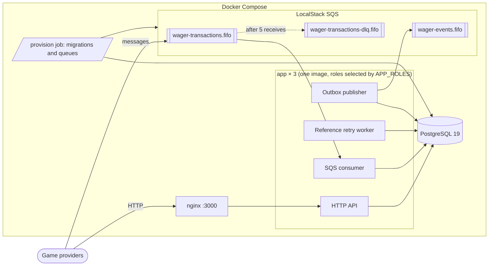
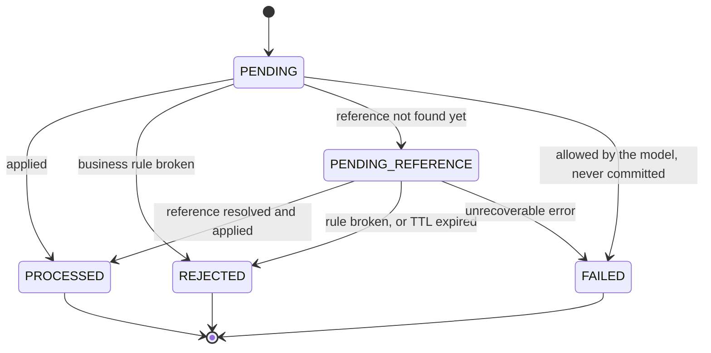

# Architecture

This document records the architectural decisions of the Distributed Wagering Processor, why each one was made, the trade-offs it accepts and the limitations it leaves. `§N` refers to sections of the challenge statement in [docs/CHALLENGE.md](docs/CHALLENGE.md). [AGENTS.md](AGENTS.md) holds the same decisions as working rules for contributors; this file holds the reasoning. Both change together.

## Implementation status

The decisions below describe the target design. Only part of it exists today:

| Area | Status |
|---|---|
| Configuration, structured logs, metrics, health checks, graceful shutdown | Implemented |
| MikroORM setup, migration tooling, SQS queue provisioning | Implemented |
| Docker Compose stack (provision job, 3 replicas, nginx, k6 profile) | Implemented |
| Test harness (per-file databases and queues, real processes) | Implemented |
| Authentication extension point | `AuthGuard` implemented; `ProviderIdentityPort` pending |
| Domain model, schema migration, wagering API, reconciliation | Designed, not implemented |
| SQS consumer, outbox publisher, reference retry worker | Designed, not implemented |
| RFC 9457 error responses | Designed, not implemented |
| OpenTelemetry tracing, load test | Deferred until the mandatory scope is green (k6 wiring exists) |

## 1. Overview

Game providers submit wagering operations for a round, `BET → WIN | LOSS | REFUND | ROLLBACK`, over HTTP or an SQS FIFO queue. Delivery is at-least-once (§3): operations arrive duplicated, out of order and concurrently on several instances, and processes may die before or after a commit. The global invariants are no duplicated credit or debit, no lost confirmed event and no negative balance.

The design follows the weights of §14: financial correctness, concurrency and idempotency come first, then messaging and failure handling. When two designs are equally correct, the simpler one wins.



## 2. Stack

| Concern | Choice | Why |
|---|---|---|
| Runtime, package manager, test runner | Bun 1.4.5 | Mandatory (§4). |
| Language | TypeScript 7, strict, ESM | Mandatory strict TypeScript. TypeScript 7, the native compiler, was verified to type-check NestJS's legacy and parameter decorators before it was adopted. |
| Framework | NestJS 12, Express adapter | Mandatory. Express is the default adapter, and nothing here needs Fastify. |
| Database | PostgreSQL 19 | Mandatory. The constraint, trigger and row-locking features the design relies on are standard PostgreSQL. |
| ORM | MikroORM 7 | Preferred by §4; see [section 8](#8-persistence-and-transactional-strategy). |
| Messaging | AWS SQS on LocalStack, AWS SDK for JavaScript v3 | Mandatory. See [section 13](#13-runtime-topology-and-operations) for the emulator choice. |
| Validation | Zod, through NestJS 12 Standard Schema support | One schema per contract, shared by the HTTP entry point and the SQS consumer. |
| Decimal arithmetic | decimal.js, only inside `Money` | Exact decimal arithmetic; see [section 4.1](#41-money). |
| Logs, metrics, health | pino, prom-client, `@nestjs/terminus` | Structured JSON logs, Prometheus metrics and separate liveness and readiness (§12). |
| Lint and format | Biome | One fast tool for both, run with zero warnings allowed. |
| Proxy | nginx | Familiar to most reviewers; its configuration is explained in [section 13](#13-runtime-topology-and-operations). |
| Load test | k6 in a container | A recognized methodology, and nothing to install on the host. |

Every version is the latest stable release, pinned exactly in `package.json` and in the Compose image tags. No package had to be held back to an older release.

## 3. Code structure

```
src/domain           entities, value objects, domain events and errors (no framework imports)
src/application      use cases and ports: repositories, unit of work, Clock, RandomSource, IdGenerator
src/infrastructure   adapters: MikroORM records and repositories, SQS, observability, configuration
src/interfaces       HTTP controllers, SQS consumer, background workers
```

Dependencies point inward: `interfaces → application → domain`, and `infrastructure` implements the ports that `application` declares. `src/domain` depends on nothing but decimal.js.

The code is one bounded context organized in layers, not a set of feature modules. The central use case writes the inbox row, the wager transaction, the wallet balance, the ledger entry and the outbox rows in a single SQL transaction. Splitting wallets, wagering and outbox into separate modules would draw boundaries straight through that transaction and force coordination between them, for no gain at this size.

## 4. Domain model (§6)

Every domain class keeps its state private, exposes explicit transitions, and is built through static factories (`create`, `from`, `open`, `receive`, `enqueue`) behind a private constructor. `rehydrate` rebuilds persisted state without revalidating transitions, and only repositories call it.

### 4.1 Money

`Money` is an immutable value object holding a decimal.js value and an ISO-4217 currency.

- **Input** accepts decimal strings with up to 2 decimal places. `NaN`, `Infinity`, scientific notation, empty strings, more than 2 decimal places and negative amounts in input contracts are rejected.
- **Output** always serializes with exactly 2 decimal places, as `{ "amount": "25.00", "currency": "BRL" }`.
- **It never rounds.** An input with more precision is rejected instead of rounded, and arithmetic is exact. This requires a decimal.js configuration with more precision than the library's default of 20 significant digits, because two amounts at the limit of `NUMERIC(20,2)` already need more than that when added.
- **Operations across currencies** throw a domain error.
- **Persistence** uses two columns, `NUMERIC(20,2)` for the amount and `CHAR(3)` for the currency. PostgreSQL's `NUMERIC` is exact and holds up to 18 integer digits at this scale. The value is rehydrated as `Money`, so the domain never sees an ORM type.

decimal.js was chosen over integer minor units because amounts arrive and leave as decimal strings: values move between the contract and the database unchanged, with no scale conversion at every boundary.

Only `BRL` is exercised end to end, as §6.1 allows, but the model stays multi-currency and currency conflicts are tested.

### 4.2 Wallet

`Wallet` is the aggregate root that owns the balance. There is at most one wallet per player and currency, and its currency never changes. `version` starts at 1 when the wallet is opened (the `OPENING` credit, when the initial balance is above zero, is part of the opening) and increments only when the balance changes. Every balance change produces exactly one ledger entry in the same SQL transaction.

### 4.3 WagerTransaction and its state machine (§6.3)



- `PROCESSED`, `REJECTED` and `FAILED` are terminal. Transitioning a terminal transaction throws `InvalidTransactionStateError`: it is a programming error, not a business path. The schema enforces the same rule with a trigger.
- `PENDING` exists only inside the SQL transaction that creates the transaction, which ends in `PROCESSED`, `REJECTED` or `PENDING_REFERENCE` before it commits. A new transaction that fails on infrastructure is rolled back and never persisted. The caller gets a transient error and can resend safely.
- `FAILED` is reserved for a transaction already persisted as `PENDING_REFERENCE` whose reprocessing hits an unrecoverable, non-business error. It carries `INTERNAL_ERROR` and stays auditable.
- `OPENING` is internal. Submitting it through the API or the queue is an invalid payload.

### 4.4 Double-entry ledger

The ledger uses double-entry bookkeeping, one of the optional differentials in §6.4. Each financial transaction produces exactly one immutable row naming the account debited, the account credited and a positive amount. A row is balanced by construction, so no trigger has to check that a transaction's lines sum to zero.

| Account | Granularity | Role |
|---|---|---|
| `PLAYER_WALLET` | one per wallet | The player's funds |
| `PROVIDER_SETTLEMENT` | one per provider and currency | The counterparty of wagering movements |
| `FUNDING` | one per currency | The source of `OPENING` credits |

Directions follow the statement's wallet perspective (§6.4): a `BET` debits the wallet.

| Operation | Debit | Credit |
|---|---|---|
| `OPENING` | `FUNDING` | `PLAYER_WALLET` |
| `BET` | `PLAYER_WALLET` | `PROVIDER_SETTLEMENT` |
| `WIN` | `PROVIDER_SETTLEMENT` | `PLAYER_WALLET` |
| `REFUND` of a `BET` | `PROVIDER_SETTLEMENT` | `PLAYER_WALLET` |
| `ROLLBACK` | the reference's credit account | the reference's debit account |
| `LOSS`, any `REJECTED` transaction | no entry | no entry |

The row also carries the wallet side of the movement: the direction, `balance_before`, `balance_after` and the wallet `version` reached by the movement. That makes every entry verifiable on its own, and the version gives the ledger a gapless order per wallet.

**Counter-account balances are never materialized.** Every bet of every player moves money to a provider's settlement account. If that account kept a balance column, every transaction would update the same row, a lock shared by all wallets, which §5 (item 6) forbids. Their balances are always derived by summing entries, which also yields each provider's net position at no extra cost.

### 4.5 Inbox, outbox and integration events

`InboxMessage` records each consumed SQS message under `(consumerName, messageId)`. `OutboxMessage` stores an integration event inside the financial transaction, with its publication attempts and the time of its next attempt.

Integration events extend the abstract `IntegrationEvent<T>`, with one concrete subclass per event. The event type and version are declared on the class, never as strings at the call site. Payloads carry `MoneyProps` (decimal strings), never `Money` instances, so they stay stable, versionable JSON (§11).

| Event | Published when |
|---|---|
| `WagerTransactionProcessed` | Any transaction is applied, including `LOSS` |
| `WagerTransactionRejected` | A transaction is rejected, including on `PENDING_REFERENCE` expiry |
| `WalletBalanceChanged` | Only when the balance changes |
| `WagerTransactionPendingReference` | A reference is missing and the transaction is parked |

## 5. Business rules and interpretations (§7)

The rules of §7 apply as written. These interpretations go beyond the statement:

1. **At most one reversal per referenced transaction.** §7 only forbids reversing a reference twice with the same operation, so read literally it would accept both a `REFUND` and a `ROLLBACK` of the same `BET`, and credit the player twice. Here a reference has at most one `PROCESSED` reversal, of either kind, enforced by a partial unique index. The second reversal is `REJECTED` with `REFERENCE_ALREADY_REVERSED`. Limitation: a `REFUND` undone by a `ROLLBACK` does not reopen the `BET` for a new `REFUND`.
2. **`WIN` may carry a reference.** When it does, the reference must resolve to a `PROCESSED` `BET` of the same provider, player, wallet, currency and round. A reference that has not arrived yet parks the `WIN` in `PENDING_REFERENCE`, like a reversal.
3. **An unknown wallet is a contract error.** Nothing is persisted: HTTP answers 404 and the queue sends the message to the DLQ. Since nothing is stored, the idempotency key is not used up, and the same request succeeds once the wallet exists. A wallet that exists but belongs to another player or currency yields a persisted `REJECTED`, which keeps referential integrity and makes the attempt auditable.
4. **A rejection is final for its idempotency key.** Resending the same request replays the rejection; changing the payload under the same key is a conflict. A provider that corrects a payload must send it as a new transaction, with a new `externalTransactionId`.
5. **A replay returns the original result,** including the balance observed when the transaction was applied (§7, rule 7), from a snapshot stored with the transaction, never from the current balance.
6. **An initial balance of zero** opens the wallet without an `OPENING` transaction, as §9 implies.

### 5.1 Failure codes (§7.2)

Every rejection carries a stable, machine-readable `failureCode`. The codes are a public contract: new ones need a documented reason, and existing ones are never renamed. `INSUFFICIENT_FUNDS` and `REVERSAL_WOULD_OVERDRAW` are deliberately distinct (§7, rule 9): a bet without funds is routine, while a reversal that would overdraw the wallet needs operational follow-up.

| Code | Meaning | What the provider should do |
|---|---|---|
| `INSUFFICIENT_FUNDS` | A `BET` exceeds the balance | Nothing to retry: the transaction is final. |
| `REVERSAL_WOULD_OVERDRAW` | A `ROLLBACK` of a `WIN` or `REFUND` would make the balance negative | Final. Reconcile with the operator: the player already spent the funds. |
| `REFERENCE_NOT_FOUND` | The reference did not arrive within the 15-minute TTL | Send the referenced transaction, then the reversal again under a new id. |
| `REFERENCE_MISMATCH` | The reference belongs to another provider, player, wallet, currency or round | Fix the payload and send it under a new id. |
| `REFERENCE_KIND_NOT_ALLOWED` | `REFUND` of anything but a `BET`; `ROLLBACK` of anything but a `BET`, `WIN` or `REFUND`; `WIN` referencing anything but a `BET` | Fix the payload and send it under a new id. |
| `REFERENCE_NOT_PROCESSED` | The reference exists but ended `REJECTED` or `FAILED` | Final. |
| `REFERENCE_ALREADY_REVERSED` | The reference already has a `PROCESSED` `REFUND` or `ROLLBACK` | Final: the money has already moved back. |
| `AMOUNT_MISMATCH` | A reversal's amount differs from its reference's (partial reversals are out of scope, §7, rule 5) | Fix the payload and send it under a new id. |
| `CURRENCY_MISMATCH` | The operation's currency differs from the wallet's | Fix the payload and send it under a new id. |
| `WALLET_PLAYER_MISMATCH` | The wallet belongs to another player | Fix the payload and send it under a new id. |
| `INTERNAL_ERROR` | Unrecoverable, non-business failure while reprocessing a pending reference (status `FAILED`) | Contact the operator; the transaction stays auditable. |

Contract errors (invalid payload, unknown resource, idempotency conflict, temporary unavailability) are not failure codes. They are protocol errors, answered as described in [section 11](#11-http-api-9).

## 6. Idempotency (§9)

- **The `Idempotency-Key` header is mandatory and authoritative.** The recommended default is `{providerId}:{externalTransactionId}`. On the queue, `data.idempotencyKey` plays the same role.
- **`payloadHash`** is the SHA-256, in hex, of the RFC 8785 (JCS) canonical JSON of the business fields: `providerId`, `externalTransactionId`, `playerId`, `walletId`, `roundId`, `gameId`, `kind`, `money` and, when present, `referenceExternalTransactionId`. Money is normalized to scale 2 before hashing, so `"25"` and `"25.00"` are the same payload. The idempotency key itself and transport metadata (`messageId`, `occurredAt`, message type, headers) are excluded. RFC 8785 fixes key order, number formatting and string escaping, so the same payload always hashes the same, on any instance.
- **Same key and same hash** is a replay: the stored response comes back with `idempotentReplay: true`. **Same key and a different hash** is a conflict (409), never a replay.
- **Persistence, not memory.** Uniqueness of `idempotency_key` and of `(provider_id, external_transaction_id)` lives in the schema, and so does the inbox's `(consumer_name, message_id)`. No in-memory cache is ever trusted for deduplication (§5, item 2).
- **Races.** The key is looked up only after the wallet row is locked, so two copies of one request on the same wallet serialize. If two copies still collide, the unique constraint rejects the second insert; the use case then rolls back and runs once more, finds the stored transaction, and answers with a replay or a conflict. A duplicate never surfaces as a 500.

## 7. Concurrency (§8)

The unit of concurrency is the wallet.

- **Pessimistic row lock.** Each use case starts by taking the wallet's row lock, `SELECT … FOR UPDATE` (`LockMode.PESSIMISTIC_WRITE`), before reading anything its decision depends on and before any other row lock. Work on one wallet is serialized; different wallets proceed in parallel.
- **Isolation.** PostgreSQL's default `READ COMMITTED` is enough: the row lock, not the isolation level, serializes the work, and a locked read always sees the latest committed balance.
- **Bounded waits.** `lock_timeout` turns a long wait into a transient error (503, or SQS redelivery) and increments the lock-conflict metric. There is no retry loop inside a request.
- **Database guards.** `CHECK (balance >= 0)`, the uniqueness of `(wallet_id, wallet_version)` in the ledger and the other schema guarantees ([section 8](#8-persistence-and-transactional-strategy)) reject what a bug in the application might let through.
- **No global lock.** There is no shared mutex, no constant-key advisory lock and no row updated by every transaction: that is why counter-account balances are derived ([section 4.4](#44-double-entry-ledger)).
- **Several instances.** No correctness depends on process memory. Workers claim rows with `FOR UPDATE SKIP LOCKED`, and migrations run in a single one-shot job.

Alternatives considered:

- **Optimistic locking with bounded retries.** Holds no locks, but a hot wallet produces retry storms, and the outcome of a race depends on retry timing.
- **Atomic conditional update** (`UPDATE … SET balance = balance - x WHERE balance >= x`). One statement and fast, but the balance rule moves out of the `Wallet` aggregate into SQL, and the ledger's `balance_before` would have to be reconstructed afterwards.

The pessimistic lock gives a deterministic result, keeps the rule inside the aggregate, and lets each ledger entry record the exact balance it moved from. The cost is that throughput on a single hot wallet is bounded by how long its lock is held.

**The mandatory scenario** (§8): with a balance of `100.00`, two concurrent `80.00` bets arrive. The first locks the wallet, debits it to `20.00`, writes one ledger entry and commits. The second waits on the lock, then reads `20.00` and is `REJECTED` with `INSUFFICIENT_FUNDS`. Retries of either one are replays. The final balance is `20.00`, with exactly one debit entry.

## 8. Persistence and transactional strategy

### ORM choice (§4)

MikroORM is the option §4 prefers, and it fits this design: an explicit Unit of Work and Identity Map, `em.transactional()` for one SQL transaction per use case, and `LockMode` for row locks.

**The domain does not depend on the ORM.** Persistence records are declared with `defineEntity` in `src/infrastructure/mikro-orm`, with no decorators, and repositories map a record to a domain object through `rehydrate` and back. This applies §6.0 to the letter, at the cost of explicit mapping code. Two alternatives were rejected:

- **Mapping domain classes through `EntitySchema`.** Less code, but MikroORM would hydrate private fields directly, bypassing the factories, and `rehydrate` would become a formality.
- **ORM decorators on domain classes.** The common tutorial approach, but it couples the domain to the ORM package, which §6.1 rules out.

### One use case, one SQL transaction (§6.5, §11)

The inbox row (SQS entry only), the wager transaction, the wallet balance and version, the ledger entry and the outbox rows commit together or not at all. Every unit of work forks its own EntityManager explicitly: there is no implicit per-request context (`registerRequestContext: false`), and the global EntityManager refuses use (`allowGlobalContext: false`).

### Schema guarantees (§5, item 9)

Uniqueness, immutability and non-negativity are enforced by PostgreSQL, not only by application code. The first migration will create:

| Guarantee | Mechanism |
|---|---|
| One wallet per player and currency | unique `(player_id, currency)` |
| No negative balance | `CHECK (balance >= 0)` |
| Idempotency | unique `idempotency_key`; unique `(provider_id, external_transaction_id)` |
| One ledger entry per transaction | unique `transaction_id` in the ledger |
| Gapless, duplicate-free wallet history | unique `(wallet_id, wallet_version)` in the ledger |
| One reversal per reference | partial unique index on the reference, over `PROCESSED` `REFUND` and `ROLLBACK` |
| Message deduplication | unique `(consumer_name, message_id)` in the inbox |
| Append-only ledger | trigger rejecting `UPDATE` and `DELETE` |
| Terminal transactions stay final | trigger rejecting updates to a terminal row |
| Well-formed entries | `CHECK (amount > 0)`; debit and credit accounts differ; `balance_after = balance_before ± amount` |

### Migrations and connections

- **Migrations** are MikroORM migrations whose SQL is reviewed by hand, and every one is reversible. A test applies all of them to an empty database, reverts them completely and applies them again, comparing a fingerprint of the schema catalog (relations, types, functions, triggers, constraints, extensions). A `down()` that forgets a trigger function fails it.
- **Application processes never run DDL.** MikroORM's `ensureDatabase` is off: databases come from Compose or the test harness, and the schema only from migrations.
- **Connections are bounded.** A 5-second connection timeout makes an unreachable database fail fast as a transient error. A 30-second `idle_in_transaction_session_timeout` lets PostgreSQL release the row locks of a process that stalled or vanished in the middle of a transaction.
- **IDs are UUIDv7,** generated by the application behind an `IdGenerator` port. They are time-ordered, which keeps index inserts local, and they exist before the insert, so events and outbox rows can reference them inside the same transaction.

## 9. Messaging (§10, §11)

### Queues

| Queue | Settings |
|---|---|
| `wager-transactions.fifo` | Inbound. Visibility timeout 30 s, long poll 20 s, redrive to the DLQ after 5 receives |
| `wager-transactions-dlq.fifo` | Dead letters of the inbound queue |
| `wager-events.fifo` | Integration events published from the outbox |

All three are FIFO queues with content-based deduplication off, so senders must provide an explicit deduplication id, and with 14 days of retention. Broker ordering and deduplication are an optimization (§5, item 3): the database enforces every invariant whatever the broker does.

### Consumer

- It calls the same use case as the HTTP entry point and deduplicates through the persistent inbox, keyed on `(consumerName, messageId)`.
- It acknowledges (deletes) a message only after the SQL transaction commits. A crash between commit and acknowledgement means a redelivery, which the inbox and the idempotency key turn into a no-op.
- Errors fall into three classes:
  - A business rejection is a final result, so the message is acknowledged.
  - A transient error extends the visibility timeout with jittered exponential backoff.
  - A permanent error (malformed message, unknown type, unknown wallet) goes straight to the DLQ.

  The redrive policy caps all of it at 5 receives.
- Producers are expected to use `walletId` as `MessageGroupId`, which preserves per-wallet order and parallelizes across wallets. Correctness does not depend on it.
- On `SIGTERM` it stops polling, then finishes the messages in flight or returns their visibility. The queue's 20-second long poll is longer than the 10-second shutdown budget, so every receive gets an `AbortSignal` that shutdown aborts first.

### Transactional outbox (§11)

- Events are written to the outbox inside the financial transaction, and nothing is published before the commit (§5, item 4).
- Publishers on every instance claim due rows with `FOR UPDATE SKIP LOCKED`, so they never block each other. They publish to `wager-events.fifo` with `MessageGroupId = walletId` and `MessageDeduplicationId = eventId`, then mark the rows as published.
- If a process dies after the commit but before publishing, the rows stay pending and another instance publishes them.
- Delivery is at-least-once. A publication repeated after a crash carries the same `eventId`, so SQS deduplicates it within its 5-minute window, and consumers deduplicate on `eventId` beyond it.
- A failed publication reschedules the row; it is never dropped ([section 10](#10-retry-policies)).

## 10. Retry policies

Pacing and termination are separate concerns, and each retry needs both.

- **Pacing** spreads retries out, so that failures arriving in a burst, typical of provider incidents, do not come back in the same instant and hit PostgreSQL or SQS together. Every retry uses exponential backoff with full jitter: `delay = random(0, min(cap, base × 2^attempt))`.
- **Termination** bounds the lifecycle, so an operation that can never succeed does not loop forever.

| Retry | Pacing | Termination |
|---|---|---|
| `PENDING_REFERENCE` reprocessing (§7.1) | Full jitter, base 1 s, cap 60 s | TTL of 15 minutes, then `REJECTED` with `REFERENCE_NOT_FOUND` |
| Outbox publishing (§11) | Full jitter, base 1 s, cap 60 s | None: retried until published |
| Inbound message with a transient error (§10) | Full jitter on the visibility timeout | 5 receives, then the DLQ |
| Wallet lock wait (§8) | No retry inside the request | `lock_timeout`: 503, or SQS redelivery |

**Missing references end on a deadline, not an attempt count.** With full jitter, the number of attempts says nothing about elapsed time: 10 attempts take about 2.5 minutes on average, with no guaranteed minimum. The deadline is fixed when the transaction is first persisted: receipt plus 15 minutes. The last attempt is scheduled at the deadline, and rejection happens only on a real lookup made at or after it. A transaction is therefore never abandoned before its TTL, and never rejected without being looked up, even after the worker was down.

The TTL errs long on purpose. A reversal rejected before its `BET` arrives leaves the player debited for a bet the provider cancelled, while waiting longer only costs a few cheap lookups. Out-of-order operations normally arrive within seconds or a few minutes.

**The outbox never gives up.** A confirmed event must never be lost (§3), so it has no TTL and no attempt limit. A gauge counts pending rows with 10 or more attempts; together with outbox lag, that is the alert signal, and the outbox table itself is the list of rows needing intervention.

**Deterministic tests.** Time and randomness come from the `Clock` and `RandomSource` ports, never from `Date.now()` or `Math.random()` in domain or application code. Base, cap, TTL and the alert threshold are configurable, so tests use short values.

## 11. HTTP API (§9)

| Endpoint | Purpose |
|---|---|
| `POST /wallets` | Open a wallet; an initial balance above zero becomes an `OPENING` credit in the same SQL transaction |
| `GET /wallets/:walletId` | Wallet and balance |
| `GET /wallets/:walletId/ledger?cursor=&limit=` | Ledger entries, paginated |
| `POST /wagering/transactions` | Submit an operation (requires `Idempotency-Key`) |
| `GET /wagering/transactions/:transactionId` | Transaction by internal id |
| `GET /providers/:providerId/wagering/transactions/:externalTransactionId` | Transaction by provider id |
| `POST /wallets/:walletId/reconciliation` | Compare the stored balance with the ledger |
| `GET /health/live`, `GET /health/ready` | Liveness and readiness, never authenticated |
| `GET /metrics` | Prometheus metrics |

### Status codes

| Situation | Status |
|---|---|
| Transaction `PROCESSED`, first call or replay | 200 |
| Wallet created | 201 |
| Transaction `PENDING_REFERENCE` | 202 |
| Invalid payload, missing `Idempotency-Key`, `kind: OPENING` | 400 |
| Unknown wallet or transaction | 404 |
| Idempotency conflict; duplicate wallet for the same player and currency | 409 |
| Transaction `REJECTED` by a business rule (the body is the transaction, with `failureCode`) | 422 |
| Transient infrastructure failure, with `Retry-After` | 503 |

§9 requires these situations to be distinguishable by status code alone, so a provider can decide whether to resend without parsing an error message:

- **A processed transaction answers 200 on the first call and on every replay.** §9 requires an identical request to get the same response. Answering 201 the first time and 200 afterwards would break that; the `idempotentReplay` field tells the two apart.
- **Business rejections get their own status (422)**, with the stored transaction as the body. Answering 200 with a `REJECTED` status in the body, as many iGaming wallet APIs do, would force providers to parse the body to learn the outcome.
- **503 means "resend with the same key".** Nothing was committed, so retrying is safe.

Protocol errors use RFC 9457 `application/problem+json` bodies with a stable, machine-readable `code`, and the mapping is identical on every endpoint.

### Ledger pagination

The cursor is the wallet `version` that each ledger entry records, encoded in base64url, and it is opaque to clients. Versions are assigned under the wallet lock, so they form a stable total order that does not depend on the clocks of different instances. A `(created_at, id)` keyset would follow those clocks, which may disagree with the real commit order.

### Reconciliation

`POST /wallets/:walletId/reconciliation` compares the stored balance with the balance rebuilt from the wallet's ledger entries, and returns both, their difference, whether they match and how many entries were checked. Both are read in one consistent snapshot, so concurrent transactions cannot produce false divergences. A divergence is never corrected silently: it is logged, counted in a metric and flagged in the response.

## 12. Authentication (§2)

Authentication is not implemented. §14 assigns it no points, and every hour spent on it would come out of financial correctness, concurrency and idempotency.

**Extension point.**

- A global `AuthGuard` (implemented) admits every request today, and a `@Public()` decorator already marks the health and metrics endpoints, which must stay open.
- A `ProviderIdentityPort` (pending) will give use cases the identity of the authenticated caller.

**Intended design.**

- An external identity provider (Keycloak or Zitadel, both suggested by §2) issues OIDC client-credentials tokens, one client per game provider.
- The guard validates the bearer token's signature against the identity provider's JWKS, checks issuer, audience and expiry, skips routes marked `@Public()`, and exposes the client through `ProviderIdentityPort`.
- A use case rejects a request whose `providerId` does not match the authenticated client. 401 (missing or invalid token) and 403 (provider mismatch) then join the status mapping.

No user table or password hashing is ever built. Messages from the queue are a trusted internal channel, but the provider identity inside them is still validated by the same domain rules: a reference, for instance, must belong to the same provider.

## 13. Runtime topology and operations

### Processes and roles

- **One image and one entry point.** `APP_ROLES` (`api`, `consumer`, `outbox`, `retry`) selects what each process runs, and Compose runs three replicas with every role. That proves every component is safe with several instances, while tests can still start a single role on its own.
- **Every process serves health and metrics** over HTTP, whatever its roles. Orchestrators and tests can therefore probe worker-only processes too. The `api` role adds the wagering API.
- **Readiness checks the dependencies.** `/health/live` checks only the process. `/health/ready` runs a real `select 1` on PostgreSQL (MikroORM connects lazily, so its connection flags prove nothing) and resolves the inbound queue on SQS. Error details go to the logs, never to the public response.
- **Shutdown is graceful and bounded.** On `SIGTERM`, NestJS closes the HTTP server, then the database and SQS clients. A watchdog forces an exit after `SHUTDOWN_TIMEOUT_MS` (10 s), which is shorter than Compose's 15-second grace period. Exit code 143 is the expected result: NestJS re-raises the signal once its cleanup is done.

### Docker Compose

| Service | Role |
|---|---|
| `postgres` | PostgreSQL 19, published on host port 55432, so that a locally installed PostgreSQL on 5432 cannot answer in its place |
| `localstack` | SQS emulator |
| `provision` | One-shot job: applies migrations and creates the queues, then exits |
| `app` × 3 | Starts only after `provision` succeeds; healthy only when ready; restarted unless stopped |
| `proxy` | nginx on port 3000, in front of the replicas |
| `k6` | Load-test runner, under the `load` profile |

- **Migrations run once.** Running them in a one-shot job means replicas never race to migrate, and application processes never run DDL.
- **nginx resolves the replicas once, at startup.** Dynamic re-resolution was tried and dropped: when a replica was killed, Docker removed its address while nginx was still waiting on it, and the retry then failed with "no live upstreams". With a static list, nginx retries the request on a live replica, and Compose restarts the proxy whenever it recreates the replicas. nginx moves a request to another replica only when the first cannot be reached. It never resends a request that already reached a replica, so a `POST` cannot be duplicated. A replica that dies loses only the requests it was serving, and clients retry those with the same idempotency key.
- **LocalStack is the only emulator.** Since March 2026 LocalStack requires an auth token (the free Hobby plan is enough), so anyone running the project needs a LocalStack account. MiniStack, which needs no token, was considered and declined, to keep a single, mature emulator.

### Configuration and secrets

- **Configuration is validated at boot.** Environment variables are checked with Zod, and an invalid value stops the process with a message that names the variable but never prints its value.
- **`MIKRO_ORM_*` variables are refused.** MikroORM would merge them into its options around that validation, and one of them can redirect every query to another database or log SQL with bound values.
- **The token stays local.** `.env` holds the LocalStack token, and it never enters Git or the Docker image.

## 14. Observability (§12)

- **Logs** are pino JSON on stdout. Each line carries `correlationId`, `messageId`, `transactionId`, `walletId` and `providerId` from an `AsyncLocalStorage` context.
  - A caller's correlation id is kept only if it uses safe characters and is at most 128 characters long; otherwise a UUIDv7 replaces it.
  - The request-context middleware runs before the body parser, so even a malformed request is logged and measured.
  - Financial keys and secrets are redacted.
  - Errors are serialized through an allowlist (type, message, stack, code, constraint, table, column, cause). PostgreSQL errors carry row values in `detail`, and the failed query in other fields, so those are never logged.
- **Metrics** come from prom-client, per process.
  - HTTP durations are labelled by matched route, never by raw path. The business metrics required by §12 (transactions by status, duplicates, retries, DLQ messages, lock conflicts, outbox lag, processing latency) arrive with the use cases.
  - Labels never carry amounts or unbounded identifiers.
  - Metrics must be read from each replica, never through the proxy, which hands each scrape to a different replica.
  - Gauges of shared state (outbox lag, DLQ depth, pending references) are computed from PostgreSQL or SQS, so every replica reports the same value.
- **Tracing** with OpenTelemetry is deferred until the mandatory scope is green. It will use manual spans from HTTP through the use case, the SQL transaction, the outbox and SQS, with trace context propagated in messages, plus a Grafana dashboard in an optional Compose profile. Spans have to be manual: the official NestJS instrumentation does not support NestJS 12 yet, and automatic instrumentation is fragile on the Bun runtime.

## 15. Testing strategy (§13)

- **PostgreSQL and SQS are always real.** Integration and concurrency tests run against PostgreSQL and LocalStack in containers; nothing is mocked (§14).
- **Isolation per file.** Each test file gets its own database, cloned in a fraction of a second from a template migrated once per run, and its own queues. Workers that scan whole tables, such as the outbox publisher, therefore never see another file's rows.
- **Real processes.** Application instances run as real OS processes built from the current sources, so multi-instance scenarios use real parallelism and crash scenarios use `SIGKILL`.
  - Windows cannot deliver a catchable `SIGTERM`, so graceful shutdown is tested against a container.
- **Determinism.** Tests wait on observable conditions, never on `sleep`.
- **Final invariant.** Every integration and concurrency test ends by asserting that the wallet balance equals the balance rebuilt from the ledger.
- **Load test.** `bun run test:load` runs k6 through the proxy; today it is a smoke run. The real load test, reporting environment, methodology, throughput, p50/p95/p99, error rate, concurrency conflicts and outbox lag, comes after the mandatory scope.

## 16. Trade-offs and known limitations

- **Hot wallets.** Throughput on a single wallet is bounded by how long its lock is held. This is accepted in exchange for deterministic results and exact ledger balances.
- **Reversals.** A `REFUND` undone by a `ROLLBACK` does not reopen the `BET` for a new `REFUND`.
- **Late references.** A reference arriving after its 15-minute TTL finds the reversal already rejected, and the provider must resend the reversal under a new id.
- **Corrections.** A rejected transaction cannot be fixed under the same idempotency key.
- **At-least-once events.** Consumers of `wager-events.fifo` must deduplicate on `eventId`.
- **LocalStack** requires an auth token to run the project, and keeps no state: if it restarts on its own, the queues are gone until `docker compose up` runs `provision` again.
- **nginx** must be restarted after a change in the number of replicas.
- **Metrics** are per process; reading them through the proxy gives a different replica's values each time.
- **Currency.** Only `BRL` is exercised end to end.
- **Authentication** is not implemented ([section 12](#12-authentication-2)).
- **Scope.** Partial reversals are out of scope, as §7 (rule 5) allows.

## 17. Open points

Not decided yet. Each is settled with the maintainer before the related code is written, and recorded here and in AGENTS.md.

- **Event ordering.** Concurrent publishers using `SKIP LOCKED` can publish one wallet's events out of order. Either document it as a limitation (consumers order by `walletVersion`) or have publishers claim rows per wallet.
- **Inbound backoff.** The base and cap of the inbound queue's visibility backoff are open. Constraint: the time a message can spend in retries before reaching the DLQ must stay below the `PENDING_REFERENCE` TTL, otherwise a reversal could be rejected while its `BET` is still being retried.
- **Timeouts.** Values for `statement_timeout` and `lock_timeout`, to be set with the use cases.
- **Problem codes.** The list of `code` values in problem+json responses.
- **Pending reference of a reversal.** When a reversal references a transaction that is itself still `PENDING_REFERENCE`, it can either wait in `PENDING_REFERENCE` or be rejected with `REFERENCE_NOT_PROCESSED`.
