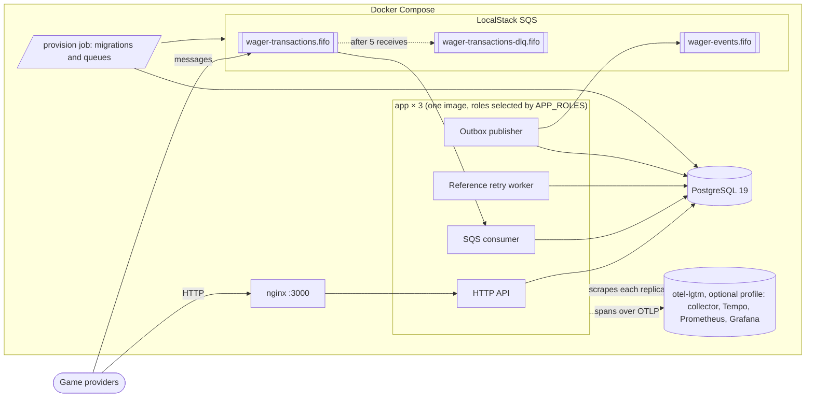
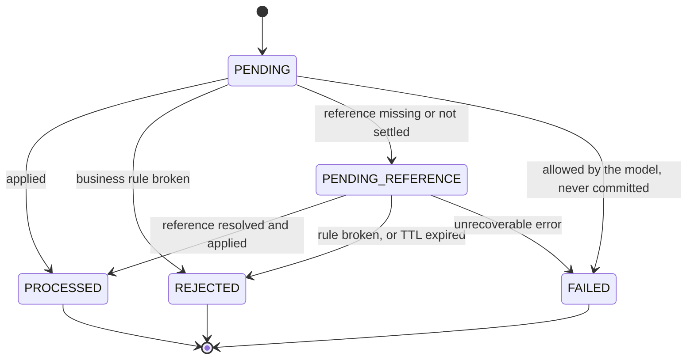

# Architecture

This document records the architectural decisions of the Distributed Wagering Processor, why each one was made, the trade-offs it accepts and the limitations it leaves. `§N` refers to sections of the challenge statement in [docs/CHALLENGE.md](docs/CHALLENGE.md). [AGENTS.md](AGENTS.md) holds the same decisions as working rules for contributors; this file holds the reasoning. Both change together.

## Implementation status

Every mandatory requirement is implemented, and so is tracing; the full load test comes next:

| Area | Status |
|---|---|
| Configuration, structured logs, metrics, health checks, graceful shutdown | Implemented; shutdown tested in a container |
| MikroORM setup, migration tooling, SQS queue provisioning | Implemented |
| Docker Compose stack (provision job, 3 replicas, nginx, k6 and observability profiles) | Implemented |
| Test harness (per-file databases and queues, real processes) | Implemented |
| Authentication extension point | `AuthGuard` implemented; `ProviderIdentityPort` pending |
| Domain model: `Money`, `Wallet`, ledger, `WagerTransaction` and its rules, events, inbox and outbox | Implemented, unit-tested |
| Persistence records and the first migration, with every schema guarantee of [section 8](#8-persistence-and-transactional-strategy) | Implemented, tested on PostgreSQL |
| Use cases (wallets, transactions, queries, reconciliation, reference retries, outbox publishing), repositories, unit of work, SQS event publisher | Implemented, tested on PostgreSQL and LocalStack |
| Wagering HTTP API, with RFC 9457 error responses | Implemented, tested over HTTP on a real process |
| SQS consumer, outbox publisher, reference retry worker, business metrics | Implemented, tested with real processes, including the multi-process scenarios of §13 |
| OpenTelemetry tracing (HTTP, use cases, SQL transactions, outbox, SQS) and the Grafana dashboard | Implemented, tested with a real process exporting to an OTLP receiver |
| Load test | A smoke run (the k6 wiring exists); the full test comes next |

## 1. Overview

Game providers submit wagering operations for a round, `BET → WIN | LOSS | REFUND | ROLLBACK`, over HTTP or an SQS FIFO queue. Delivery is at-least-once (§3): operations arrive duplicated, out of order and concurrently on several instances, and processes may die before or after a commit. The global invariants are no duplicated credit or debit, no lost confirmed event and no negative balance.

The design follows the weights of §14: financial correctness, concurrency and idempotency come first, then messaging and failure handling. When two designs are equally correct, the simpler one wins.



## 2. Stack

| Concern | Choice | Why |
|---|---|---|
| Runtime, package manager, test runner | Bun 1.4.5 | Mandatory (§4). |
| Language | TypeScript 7, strict, ESM | Mandatory strict TypeScript. TypeScript 7, the native compiler, was verified to type-check NestJS's legacy and parameter decorators before it was adopted. |
| Framework | NestJS 12, Express adapter | Mandatory. Express is the default adapter, and nothing here needs Fastify. |
| Database | PostgreSQL 19 | Mandatory. The constraint, trigger and row-locking features the design relies on are standard PostgreSQL. |
| ORM | MikroORM 7 | Preferred by §4; see [section 8](#8-persistence-and-transactional-strategy). |
| Messaging | AWS SQS on LocalStack, AWS SDK for JavaScript v3 | Mandatory. See [section 13](#13-runtime-topology-and-operations) for the emulator choice. |
| Validation | Zod, through NestJS 12 Standard Schema support | One schema per contract, shared by the HTTP entry point and the SQS consumer. |
| Decimal arithmetic | decimal.js, only inside `Money` | Exact decimal arithmetic; see [section 4.1](#41-money). |
| Logs, metrics, health | pino, prom-client, `@nestjs/terminus` | Structured JSON logs, Prometheus metrics and separate liveness and readiness (§12). |
| Tracing | OpenTelemetry (API 1.10, SDK 3.1), OTLP over HTTP; grafana/otel-lgtm in an optional Compose profile | Vendor-neutral spans and W3C context propagation; one container gives a collector, Tempo, Prometheus and Grafana for local use. See [section 14](#14-observability-12). |
| Lint and format | Biome | One fast tool for both, run with zero warnings allowed. |
| Proxy | nginx | Familiar to most reviewers; its configuration is explained in [section 13](#13-runtime-topology-and-operations). |
| Load test | k6 in a container | A recognized methodology, and nothing to install on the host. |

Every version is the latest stable release, pinned exactly in `package.json` and in the Compose image tags. No package had to be held back to an older release.

## 3. Code structure

```
src/domain           entities, value objects, domain events and errors (no framework imports)
src/application      use cases and ports: repositories, unit of work, Clock, RandomSource, IdGenerator
src/infrastructure   adapters: MikroORM records and repositories, SQS, observability, configuration
src/interfaces       HTTP controllers, SQS consumer, background workers
```

Dependencies point inward: `interfaces → application → domain`, and `infrastructure` implements the ports that `application` declares. `src/domain` depends on no package but decimal.js; it also uses Node's built-in `node:crypto` for the payload hash. A unit test scans its imports and fails on anything else.

The application layer holds the use cases, one class each, and the ports they need: repositories bound to a unit of work, a clock, an id generator and an event publisher. Use cases take plain commands and return plain views (decimal strings, ISO dates); they do no logging and record no metrics, because their results say what happened, and the interfaces that call them log and measure from those results. `createUseCases` in `src/infrastructure/use-cases.ts` is the composition root: it wires the MikroORM unit of work, the system clock, UUIDv7 ids and the SQS publisher, and tests replace any of them.

The interfaces are thin. Each role (`api`, `consumer`, `outbox`, `retry`) is a NestJS module that `AppModule` imports only when `APP_ROLES` lists it. The HTTP controllers and the SQS consumer validate their input with the same Zod contracts (`src/interfaces/contracts.ts`), whose rules come from the layer that owns them (identifier limits from the use cases, amounts and currencies from `Money`), call the same use case, and record metrics from its result through `WageringTelemetry`. The background loops share their pacing helpers. They are all aborted in `onModuleDestroy`, which NestJS runs for every module before any `beforeApplicationShutdown` (that hook runs one module after another), and awaited in `beforeApplicationShutdown`, before the ORM and the SQS client close.

The code is one bounded context organized in layers, not a set of feature modules. The central use case writes the inbox row, the wager transaction, the wallet balance, the ledger entry and the outbox rows in a single SQL transaction. Splitting wallets, wagering and outbox into separate modules would draw boundaries straight through that transaction and force coordination between them, for no gain at this size.

## 4. Domain model (§6)

Every domain class keeps its state private, exposes explicit transitions, and is built through static factories (`create`, `from`, `open`, `receive`, `enqueue`) behind a private constructor. `rehydrate` rebuilds persisted state without revalidating transitions, and only repositories call it.

### 4.1 Money

`Money` is an immutable value object holding a decimal.js value and an ISO-4217 currency.

- **Input** accepts decimal strings with up to 2 decimal places. `NaN`, `Infinity`, scientific notation, empty strings, more than 2 decimal places and negative amounts in input contracts are rejected.
- **Output** always serializes with exactly 2 decimal places, as `{ "amount": "25.00", "currency": "BRL" }`.
- **It never rounds.** An input with more precision is rejected instead of rounded, and arithmetic is exact. This requires a decimal.js configuration with more precision than the library's default of 20 significant digits, because two amounts at the limit of `NUMERIC(20,2)` already need more than that when added.
- **Operations across currencies** throw a domain error.
- **Persistence** uses two columns, `NUMERIC(20,2)` for the amount and `CHAR(3)` for the currency. PostgreSQL's `NUMERIC` is exact and holds up to 18 integer digits at this scale. The value is rehydrated as `Money`, so the domain never sees an ORM type.

decimal.js was chosen over integer minor units because amounts arrive and leave as decimal strings: values move between the contract and the database unchanged, with no scale conversion at every boundary.

Only `BRL` is exercised end to end, as §6.1 allows, but the model stays multi-currency and currency conflicts are tested.

### 4.2 Wallet

`Wallet` is the aggregate root that owns the balance. There is at most one wallet per player and currency, and its currency never changes. `version` starts at 1 when the wallet is opened (the `OPENING` credit, when the initial balance is above zero, is part of the opening) and increments only when the balance changes. Every balance change produces exactly one ledger entry in the same SQL transaction: `debit` and `credit` return the entry they produced, built and validated before the wallet changes, so a refused movement leaves the wallet untouched. A wallet opened at zero has no ledger entry, so its first movement is version 2.

The business rules live in one function, `applyWagerTransaction`, which takes the locked wallet, the transaction, its resolved reference (if any) and the retry policy, and returns the outcome: `PROCESSED` with its ledger entry, `REJECTED` with its failure code, or `PENDING_REFERENCE`. It has no I/O; the use cases will load and lock what it needs and persist what it changed.

### 4.3 WagerTransaction and its state machine (§6.3)



- `PROCESSED`, `REJECTED` and `FAILED` are terminal. Transitioning a terminal transaction throws `InvalidTransactionStateError`: it is a programming error, not a business path. The schema enforces the same rule with a trigger.
- `PENDING` exists only inside the SQL transaction that creates the transaction, which ends in `PROCESSED`, `REJECTED` or `PENDING_REFERENCE` before it commits. A new transaction that fails on infrastructure is rolled back and never persisted. The caller gets a transient error and can resend safely.
- `FAILED` is reserved for a transaction already persisted as `PENDING_REFERENCE` whose reprocessing hits an unrecoverable, non-business error. It carries `INTERNAL_ERROR` and stays auditable.
- `OPENING` is internal. Submitting it through the API or the queue is an invalid payload. It is created already `PROCESSED`, together with the wallet, and has no provider fields and no idempotency key: it records the initial balance, not a provider's operation. A partial unique index allows one per wallet.

### 4.4 Double-entry ledger

The ledger uses double-entry bookkeeping, one of the optional differentials in §6.4. Each financial transaction produces exactly one immutable row naming the account debited, the account credited and a positive amount. A row is balanced by construction, so no trigger has to check that a transaction's lines sum to zero.

| Account | Granularity | Role |
|---|---|---|
| `PLAYER_WALLET` | one per wallet | The player's funds |
| `PROVIDER_SETTLEMENT` | one per provider and currency | The counterparty of wagering movements |
| `FUNDING` | one per currency | The source of `OPENING` credits |

Directions follow the statement's wallet perspective (§6.4): a `BET` debits the wallet.

| Operation | Debit | Credit |
|---|---|---|
| `OPENING` | `FUNDING` | `PLAYER_WALLET` |
| `BET` | `PLAYER_WALLET` | `PROVIDER_SETTLEMENT` |
| `WIN` | `PROVIDER_SETTLEMENT` | `PLAYER_WALLET` |
| `REFUND` of a `BET` | `PROVIDER_SETTLEMENT` | `PLAYER_WALLET` |
| `ROLLBACK` | the reference's credit account | the reference's debit account |
| `LOSS`, any `REJECTED` transaction | no entry | no entry |

The row also carries the wallet side of the movement: the direction, `balance_before`, `balance_after` and the wallet `version` reached by the movement. That makes every entry verifiable on its own, and the version gives the ledger a gapless order per wallet.

**Counter-account balances are never materialized.** Every bet of every player moves money to a provider's settlement account. If that account kept a balance column, every transaction would update the same row, a lock shared by all wallets, which §5 (item 6) forbids. Their balances are always derived by summing entries, which also yields each provider's net position at no extra cost.

### 4.5 Inbox, outbox and integration events

`InboxMessage` records each consumed SQS message under `(consumerName, messageId)`. `OutboxMessage` stores an integration event inside the financial transaction, with its publication attempts, the time of its next attempt and, when that transaction was traced, its trace context, which is opaque to the domain ([section 14](#14-observability-12)).

Integration events extend the abstract `IntegrationEvent<T>`, with one concrete subclass per event. The event type and version are declared on the class, never as strings at the call site. Payloads carry `MoneyProps` (decimal strings), never `Money` instances, so they stay stable, versionable JSON (§11).

| Event | Published when |
|---|---|
| `WagerTransactionProcessed` | Any transaction is applied, including `LOSS` and the `OPENING` |
| `WagerTransactionRejected` | A transaction is rejected, including on `PENDING_REFERENCE` expiry |
| `WalletBalanceChanged` | Only when the balance changes, right after the transaction's own event |
| `WagerTransactionPendingReference` | A reference is missing and the transaction is parked (not again on each new attempt) |
| `WagerTransactionFailed` | A parked transaction ends `FAILED` |

Every terminal outcome has its event, so a consumer always learns that a transaction is over. Opening a wallet above zero raises the `OPENING`'s `WagerTransactionProcessed` and `WalletBalanceChanged`; opening at zero raises nothing, and there is no separate wallet-creation event.

## 5. Business rules and interpretations (§7)

The rules of §7 apply as written. These interpretations go beyond the statement:

1. **At most one reversal per referenced transaction.** §7 only forbids reversing a reference twice with the same operation, so read literally it would accept both a `REFUND` and a `ROLLBACK` of the same `BET`, and credit the player twice. Here a reference has at most one `PROCESSED` reversal, of either kind, enforced by a partial unique index. The second reversal is `REJECTED` with `REFERENCE_ALREADY_REVERSED`. Limitation: a `REFUND` undone by a `ROLLBACK` does not reopen the `BET` for a new `REFUND`.
2. **`WIN` and `LOSS` may carry a reference.** When they do, the reference must resolve to a `PROCESSED` `BET` of the same provider, player, wallet, currency and round. A reference that has not arrived yet parks them in `PENDING_REFERENCE`, like a reversal. A `WIN` or `LOSS` for a `BET` that was reversed is `REJECTED` with `REFERENCE_ALREADY_REVERSED`: the stake went back to the player, so there is nothing left to settle. A `BET` never references another transaction; one that does is an invalid payload.
3. **An unknown wallet is a contract error.** Nothing is persisted: HTTP answers 404 and the queue sends the message to the DLQ. Since nothing is stored, the idempotency key is not used up, and the same request succeeds once the wallet exists. A wallet that exists but belongs to another player or currency yields a persisted `REJECTED`, which keeps referential integrity and makes the attempt auditable.
4. **A rejection is final for its idempotency key.** Resending the same request replays the rejection; changing the payload under the same key is a conflict. A provider that corrects a payload must send it as a new transaction, with a new `externalTransactionId`.
5. **A replay returns the original result,** including the balance observed when the transaction was applied (§7, rule 7), from a snapshot stored with the transaction, never from the current balance.
6. **An initial balance of zero** opens the wallet without an `OPENING` transaction, as §9 implies.
7. **A pending reference makes its dependants wait.** When a transaction references one that is itself still `PENDING_REFERENCE` (the `ROLLBACK` of a `REFUND` whose `BET` has not arrived), it is parked in `PENDING_REFERENCE` too, with its own 15-minute deadline. It proceeds once the reference is `PROCESSED`. It is `REJECTED` with `REFERENCE_NOT_PROCESSED` if the reference ends `REJECTED` or `FAILED`, or is still pending when its own deadline passes. The worker handles the oldest pending transactions first, so chains resolve in order. Rejecting such a reversal at once would let an out-of-order chain end wrong: the `ROLLBACK` rejected, then the `REFUND` applied, leaving the player with a credit the provider meant to undo.
8. **Amounts.** Every operation moves an amount above zero, except a `LOSS`, which may record zero: it reports the outcome of a round and never moves the balance. A reversal must have its reference's amount.
9. **Rule precedence.** When several rules are broken, the first in this order is reported: the wallet's player, the currency, then the reference (missing, scope, kind, still pending, not processed, already reversed, amount), then funds. The scope of a reference is checked before anything else about it, so a provider learns nothing about transactions outside its own player, wallet and round.
10. **A wallet mismatch discloses no balance.** A transaction rejected with `WALLET_PLAYER_MISMATCH` or `CURRENCY_MISMATCH` stores no observed balance, so neither its response nor its event shows the balance of a wallet that is not the caller's.

### 5.1 Failure codes (§7.2)

Every rejection carries a stable, machine-readable `failureCode`. The codes are a public contract: new ones need a documented reason, and existing ones are never renamed. `INSUFFICIENT_FUNDS` and `REVERSAL_WOULD_OVERDRAW` are deliberately distinct (§7, rule 9): a bet without funds is routine, while a reversal that would overdraw the wallet needs operational follow-up.

| Code | Meaning | What the provider should do |
|---|---|---|
| `INSUFFICIENT_FUNDS` | A `BET` exceeds the balance | Nothing to retry: the transaction is final. |
| `REVERSAL_WOULD_OVERDRAW` | A `ROLLBACK` of a `WIN` or `REFUND` would make the balance negative | Final. Reconcile with the operator: the player already spent the funds. |
| `REFERENCE_NOT_FOUND` | The reference did not arrive within the 15-minute TTL | Send the referenced transaction, then the reversal again under a new id. |
| `REFERENCE_MISMATCH` | The reference belongs to another provider, player, wallet, currency or round | Fix the payload and send it under a new id. |
| `REFERENCE_KIND_NOT_ALLOWED` | `REFUND` of anything but a `BET`; `ROLLBACK` of anything but a `BET`, `WIN` or `REFUND`; `WIN` or `LOSS` referencing anything but a `BET` | Fix the payload and send it under a new id. |
| `REFERENCE_NOT_PROCESSED` | The reference exists but ended `REJECTED` or `FAILED`, or was still `PENDING_REFERENCE` when this transaction's deadline passed | Final. |
| `REFERENCE_ALREADY_REVERSED` | The reference already has a `PROCESSED` `REFUND` or `ROLLBACK`: a second reversal, or a `WIN` or `LOSS` for a reversed `BET` | Final: the money has already moved back. |
| `AMOUNT_MISMATCH` | A reversal's amount differs from its reference's (partial reversals are out of scope, §7, rule 5) | Fix the payload and send it under a new id. |
| `CURRENCY_MISMATCH` | The operation's currency differs from the wallet's | Fix the payload and send it under a new id. |
| `WALLET_PLAYER_MISMATCH` | The wallet belongs to another player | Fix the payload and send it under a new id. |
| `INTERNAL_ERROR` | Unrecoverable, non-business failure while reprocessing a pending reference (status `FAILED`) | Contact the operator; the transaction stays auditable. |

Contract errors (invalid payload, unknown resource, idempotency conflict, temporary unavailability) are not failure codes. They are protocol errors, answered as described in [section 11](#11-http-api-9).

## 6. Idempotency (§9)

- **The `Idempotency-Key` header is mandatory and authoritative.** The recommended default is `{providerId}:{externalTransactionId}`. On the queue, `data.idempotencyKey` plays the same role.
- **`payloadHash`** is the SHA-256, in hex, of the RFC 8785 (JCS) canonical JSON of the business fields: `providerId`, `externalTransactionId`, `playerId`, `walletId`, `roundId`, `gameId`, `kind`, `money` and, when present, `referenceExternalTransactionId`. Money is normalized to scale 2 before hashing, so `"25"` and `"25.00"` are the same payload. The idempotency key itself and transport metadata (`messageId`, `occurredAt`, message type, headers) are excluded. RFC 8785 fixes key order, number formatting and string escaping, so the same payload always hashes the same, on any instance.
- **Same key and same hash** is a replay: the stored response comes back with `idempotentReplay: true`. **Same key and a different hash** is a conflict (409), never a replay.
- **Persistence, not memory.** Uniqueness of `idempotency_key` and of `(provider_id, external_transaction_id)` lives in the schema, and so does the inbox's `(consumer_name, message_id)`. No in-memory cache is ever trusted for deduplication (§5, item 2).
- **Races.** The key is looked up only after the wallet row is locked, so two copies of one request on the same wallet serialize. If two copies still collide, the unique constraint rejects the second insert; the use case then rolls back and runs once more, finds the stored transaction, and answers with a replay or a conflict. A duplicate never surfaces as a 500.

## 7. Concurrency (§8)

The unit of concurrency is the wallet.

- **Pessimistic row lock.** Each use case starts by taking the wallet's row lock, `SELECT … FOR UPDATE` (`LockMode.PESSIMISTIC_WRITE`), before reading anything its decision depends on and before any other row lock. Work on one wallet is serialized; different wallets proceed in parallel.
- **Isolation.** PostgreSQL's default `READ COMMITTED` is enough: the row lock, not the isolation level, serializes the work, and a locked read always sees the latest committed balance.
- **Bounded waits.** A 2-second `lock_timeout` turns a long wait into a transient error (503 `WALLET_BUSY`, or SQS redelivery) and increments the lock-conflict metric. Each transaction holds the wallet lock for milliseconds, so 2 seconds absorb the queue of a contended wallet, such as the 50 parallel copies of one bet that §13 tests, and still answer within the timeouts providers typically allow a wallet call. There is no retry loop inside a request.
- **Database guards.** `CHECK (balance >= 0)`, the uniqueness of `(wallet_id, wallet_version)` in the ledger and the other schema guarantees ([section 8](#8-persistence-and-transactional-strategy)) reject what a bug in the application might let through.
- **No global lock.** There is no shared mutex, no constant-key advisory lock and no row updated or locked by every transaction: that is why counter-account balances are derived ([section 4.4](#44-double-entry-ledger)), and why no foreign key points at a counter-account. A foreign-key check takes a `FOR KEY SHARE` lock on the referenced row at every commit; those locks do not block each other, but on a provider's settlement account every bet of every player would rewrite the same row's lock state, and any stronger lock on it, even by mistake, would serialize them all. Accounts are insert-only, and the deferred ledger check reads the counter-account without locking it.
- **Several instances.** No correctness depends on process memory. The outbox publisher claims rows with `FOR UPDATE SKIP LOCKED`, and migrations run in a single one-shot job.
- **Workers keep the lock order.** The retry worker picks due transactions without locking them, locks their wallet, then re-reads the transaction under that lock, so it never holds a transaction row while waiting for a wallet that a use case holds.

Alternatives considered:

- **Optimistic locking with bounded retries.** Holds no locks, but a hot wallet produces retry storms, and the outcome of a race depends on retry timing.
- **Atomic conditional update** (`UPDATE … SET balance = balance - x WHERE balance >= x`). One statement and fast, but the balance rule moves out of the `Wallet` aggregate into SQL, and the ledger's `balance_before` would have to be reconstructed afterwards.

The pessimistic lock gives a deterministic result, keeps the rule inside the aggregate, and lets each ledger entry record the exact balance it moved from. The cost is that throughput on a single hot wallet is bounded by how long its lock is held.

**The mandatory scenario** (§8): with a balance of `100.00`, two concurrent `80.00` bets arrive. The first locks the wallet, debits it to `20.00`, writes one ledger entry and commits. The second waits on the lock, then reads `20.00` and is `REJECTED` with `INSUFFICIENT_FUNDS`. Retries of either one are replays. The final balance is `20.00`, with exactly one debit entry.

## 8. Persistence and transactional strategy

### ORM choice (§4)

MikroORM is the option §4 prefers, and it fits this design: an explicit Unit of Work and Identity Map, `em.transactional()` for one SQL transaction per use case, and `LockMode` for row locks.

**The domain does not depend on the ORM.** Persistence records are declared with `defineEntity` in `src/infrastructure/mikro-orm`, with no decorators, and repositories map a record to a domain object through `rehydrate` and back. This applies §6.0 to the letter, at the cost of explicit mapping code. Two alternatives were rejected:

- **Mapping domain classes through `EntitySchema`.** Less code, but MikroORM would hydrate private fields directly, bypassing the factories, and `rehydrate` would become a formality.
- **ORM decorators on domain classes.** The common tutorial approach, but it couples the domain to the ORM package, which §6.1 rules out.

### One use case, one SQL transaction (§6.5, §11)

The inbox row (SQS entry only), the wager transaction, the wallet balance and version, the ledger entry and the outbox rows commit together or not at all. Every unit of work forks its own EntityManager explicitly: there is no implicit per-request context (`registerRequestContext: false`), and the global EntityManager refuses use (`allowGlobalContext: false`).

`SubmitWagerTransaction` runs in this order. First, before any SQL: validate the request (identifier limits; no control characters, unpaired surrogates, U+FFFE or U+FFFF; a lowercase UUID wallet id; the kind; the money) and build the transaction, so an invalid request never takes a lock. Then, in the SQL transaction: lock the wallet; look the idempotency key up; if the request came from the queue and its message is already in the inbox, answer from the transaction it produced (the same message id with another payload is refused as an inbox conflict); otherwise the key answers a replay or a conflict; look the provider's id up, which answers a conflict; resolve the reference and whether it was reversed; get or create the provider's settlement account; apply the rules; write the balance and its entry when the transaction moves money, then the transaction, its events and the inbox row. A unique violation on the idempotency key, the provider's id or the inbox means that a copy of the request on another wallet committed first (copies on the same wallet wait for its lock and become replays): the use case runs once more, finds that row and answers from it. The reversal index is retried the same way, only as a backstop: every reversal runs under its reference's wallet lock, which rules out a genuine race there. The second run looks the winner's row up before inserting (a committed reversal makes it reject), so a violation on it is no contention but a bug, such as a unique index out of step with the lookups: it propagates as a 500 (`UNEXPECTED_ERROR`), with nothing committed, instead of a `WALLET_BUSY` that every resend would meet again.

### Repositories and the unit of work

- **Reads bypass the identity map.** A unit of work reads a row again after taking a lock precisely to see its latest committed state, so a cached entity would defeat the lock.
- **Writes are native statements,** run at once and in the order of the calls, so a unique violation surfaces where it happens; the deferred schema checks run at the commit.
- **Failures are translated by SQLSTATE.** MikroORM types only some of them, so `translateDatabaseError` reads the code: a unique violation becomes a race named by meaning (idempotency key, provider id, inbox, reversal, wallet owner), a lock timeout or deadlock a busy wallet (`WALLET_BUSY`), and a statement timeout, a connection failure, a server shutdown, exhausted resources (disk, memory, connections) or an I/O error an unavailable dependency (`DEPENDENCY_UNAVAILABLE`). The busy wallet and the unavailable dependency are the failures that pass, so a parked transaction that meets one stays parked instead of ending `FAILED`; how reprocessing treats a unique violation is described in [section 10](#10-retry-policies). Schema guards and bugs pass through untouched, as 500s.
- **Accounts are read or created, never locked.** A settlement account is shared by every wallet of its provider, so it is created with `INSERT … ON CONFLICT DO NOTHING` and read; nothing ever updates or locks it.

### Schema guarantees (§5, item 9)

Uniqueness, immutability and non-negativity are enforced by PostgreSQL, not only by application code. The first migration creates six tables (`wallets`, `ledger_accounts`, `wager_transactions`, `ledger_entries`, `inbox_messages`, `outbox_messages`) and these guarantees; the second adds the outbox's trace context. Each guarantee is proved by `test/integration/schema.test.ts` with raw SQL that bypasses the application:

| Guarantee | Mechanism |
|---|---|
| One wallet per player and currency | unique `(player_id, currency)` |
| No negative balance | `CHECK (balance >= 0)`, on the wallet and on both balances of every entry |
| Idempotency | unique `idempotency_key`; unique `(provider_id, external_transaction_id)` |
| One ledger entry per transaction | unique `transaction_id` in the ledger |
| Gapless, duplicate-free wallet history | unique `(wallet_id, wallet_version)` in the ledger, plus the chain check below |
| One reversal per reference | partial unique index on the reference, over `PROCESSED` `REFUND` and `ROLLBACK` |
| One `OPENING` per wallet | partial unique index on the wallet, over `OPENING` |
| Message deduplication | primary key `(consumer_name, message_id)` in the inbox |
| Append-only ledger | trigger rejecting `UPDATE`, `DELETE` and `TRUNCATE`, on entries and on accounts |
| No confirmed event is lost | trigger: an unpublished outbox row cannot be deleted or truncated, and only its publication schedule changes (attempts only go up); a published row is final and may then be purged |
| An event keeps its trace | the outbox `trace_context` is null or a JSON object (`CHECK`), and the same trigger freezes it with the event's other columns |
| Terminal transactions stay final | trigger: only a `PENDING_REFERENCE` row may change, and then only its outcome (status, failure code, observed balance, schedule); its deadline is fixed; nothing is deleted; `FAILED` is reachable only by that update |
| Wallets keep their identity | trigger: owner, currency and creation time never change; wallets are never deleted |
| Valid states | `CHECK`s: `PENDING` is never stored; failure codes only on `REJECTED` (never `INTERNAL_ERROR`) and `FAILED` (always `INTERNAL_ERROR`); `processed_at` exactly on `PROCESSED`; a parked row has a deadline and a next attempt no later than it; reference rules per kind; provider fields null only for `OPENING`; no observed balance on a wallet mismatch |
| Well-formed entries | `CHECK (amount > 0)`; debit and credit accounts differ; the wallet is the debited account of a `DEBIT` and the credited one of a `CREDIT`; `balance_after = balance_before ± amount` |
| One currency per movement | composite foreign key `(wallet, currency)` from each entry; the counter-account's currency is checked at commit |

**Balance, ledger and transactions agree at every commit.** Deferred constraint triggers run at `COMMIT`, when every row of the unit of work is visible, and check that:

- every `PROCESSED` transaction that moves the balance has its entry, and every entry records a `PROCESSED` transaction that moves the balance, with its wallet, amount and currency, in the direction its kind implies (a `ROLLBACK` mirrors its reference), against the right counter-account in the same currency (`FUNDING` for the `OPENING`, which is always version 1; the provider's own settlement account otherwise);
- the snapshot stored with an applied transaction is the balance its entry ends at, so every replay of that frozen row answers what the first call did;
- the entries of a wallet form an unbroken chain from a zero balance, each starting where the previous one ended;
- the wallet holds the balance of its last entry, at that entry's version, and has its own ledger account. This is checked from both sides, so an entry written without touching the wallet row cannot slip in;
- an applied transaction names its wallet's player and currency;
- an applied transaction's reference is the provider's transaction it names: `PROCESSED`, same wallet, round and currency, of an allowed kind, with the same amount for a reversal, and never a reversed `BET` for a `WIN` or `LOSS`.

Together these make `wallet.balance == balance rebuilt from the ledger` a property of the schema, not only an assertion in tests. The checks read rows by primary key or unique index, a handful of lookups per commit, and lock nothing. The remaining foreign keys lock only rows that belong to one wallet or one transaction.

Foreign keys are deferred too, so a unit of work may write its rows in any order. Unique constraints are not deferred: an idempotency race fails at the insert, where the use case resolves it. A guard violation raises SQLSTATE 23000 and a consistency violation 23514, each naming the rule in the error's `constraint` field, which the log serializer keeps. Both mean a bug, answered 500; only a unique violation on the idempotency keys is an expected race. Their messages carry ids and versions, never amounts, because messages reach the logs; amounts go to `DETAIL`, which the serializer drops.

The core reference rules are therefore written twice, in `applyWagerTransaction` and in SQL. The domain decides the outcome and its failure code; the schema only refuses a state that should never exist, whatever code wrote it.

### Persistence records

Records declare columns, primary keys and plain unique constraints, and nothing else: no relations, so repositories handle ids explicitly and nothing is loaded lazily. MikroORM cannot describe CHECKs, triggers, partial indexes or deferrable foreign keys, so its own schema diff against a migrated database would drop all of them. New migrations are therefore generated from the snapshot (the records as of the last migration), never from the database, and their SQL is reviewed by hand. Amounts map to decimal strings, never numbers. The outbox `sequence_number` is an identity column the application never writes.

### Migrations and connections

- **Migrations** are MikroORM migrations whose SQL is reviewed by hand, and every one is reversible. A test applies them to an empty database one at a time, reverts them one at a time and applies them again, comparing a fingerprint of the schema catalog after every step: relations, columns, index, trigger and constraint definitions, types, function bodies (whitespace aside) and extensions. Each `down()` must leave exactly the schema the migrations before it built, so one that forgets a trigger function, or restores a function by name but not its body, fails it.
- **Application processes never run DDL.** MikroORM's `ensureDatabase` is off: databases come from Compose or the test harness, and the schema only from migrations.
- **Connections are bounded.** A 5-second connection timeout makes an unreachable database fail fast as a transient error. A 30-second `idle_in_transaction_session_timeout` lets PostgreSQL release the row locks of a process that stalled or vanished in the middle of a transaction.
- **Statements are bounded too.** The application's sessions run with a 2-second `lock_timeout` ([section 7](#7-concurrency-8)) and a 5-second `statement_timeout`, which stops a runaway query, such as a large ledger page or a reconciliation, from holding a connection. The pg driver sends both as session settings when the application's pool opens a connection; the migration scripts open their own connections without them. Both are configurable.
- **IDs are UUIDv7,** generated by the application behind an `IdGenerator` port. They are time-ordered, which keeps index inserts local, and they exist before the insert, so events and outbox rows can reference them inside the same transaction.

## 9. Messaging (§10, §11)

### Queues

| Queue | Settings |
|---|---|
| `wager-transactions.fifo` | Inbound. Visibility timeout 30 s, long poll 20 s, redrive to the DLQ after 5 receives |
| `wager-transactions-dlq.fifo` | Dead letters of the inbound queue |
| `wager-events.fifo` | Integration events published from the outbox |

All three are FIFO queues with content-based deduplication off, so senders must provide an explicit deduplication id, and with 14 days of retention. Broker ordering and deduplication are an optimization (§5, item 3): the database enforces every invariant whatever the broker does.

### Consumer

- It reads §10's message (`messageId`, `type: WagerTransactionRequested`, `occurredAt`, `data` with the idempotency key in `data.idempotencyKey`), validates `data` with the same contract as the HTTP body, calls the same use case as the HTTP entry point, and deduplicates through the persistent inbox, keyed on `(wager-transactions, messageId)`. Unknown envelope fields are ignored, so producers can add transport metadata; unknown transaction fields are refused, as over HTTP.
- It acknowledges (deletes) a message only after the SQL transaction commits. A crash between commit and acknowledgement means a redelivery, which the inbox and the idempotency key turn into a no-op.
- Errors fall into four classes:
  - A business rejection is a final result, so the message is acknowledged; so is any stored outcome a replay returns.
  - A transient error is retried. A busy wallet extends the visibility timeout with full-jitter exponential backoff: base 5 s, cap 60 s. An unavailable dependency pauses the consumer instead (below).
  - A permanent error goes straight to the DLQ: a malformed message, an unknown type, a validation failure, an unknown wallet, and any conflict (the same message id with another payload, the same idempotency key with another payload, the provider's id under another key). Over HTTP a conflict is a 409 to the caller; from the queue nobody would ever see it if the message were acknowledged.
  - An unexpected error, a bug, is retried like a transient one, logged and counted. A sporadic bug resolves itself; a persistent one reaches the DLQ through the redrive policy instead of being dropped on its first occurrence. Nothing is committed either way.

  The redrive policy caps the retries at 5 receives, at most about 2 min 15 s.
- **Dead-lettering is a copy and a delete.** SQS has no call that moves a message to the DLQ, so the consumer sends a copy (same body, group and attributes, the original SQS message id as `MessageDeduplicationId`, and a `deadLetterReason` attribute) and then deletes the original. A crash in between leaves a duplicate in the DLQ, never a lost message, and the deduplication id absorbs it within five minutes. Messages moved by the redrive policy carry no reason: they ran out of receives.
- Messages of one group, a wallet, are processed in order; the groups of a batch in parallel. When one meets a busy wallet, the rest of its group in the batch is handed back at once: FIFO delivers none of a group while its head is invisible, so a later bet cannot overtake an earlier one that met a lock timeout, and the neighbours would have met the same lock anyway. After a bug the group goes on: held back, the neighbours of a message bound for the DLQ would spend their receives along with it and follow it there. A sporadic bug can then let a later message overtake it, which the rules tolerate (an out-of-order reversal waits in `PENDING_REFERENCE`). A `correlationId` message attribute is kept when it is safe to log, like the HTTP header, and a `traceparent` attribute makes the message's processing part of the producer's trace.
- **It pauses during outages.** While PostgreSQL or SQS is unreachable, the consumer stops receiving and probes the dependency with backoff before resuming. Every receive counts against the redrive limit, so the consumer checks PostgreSQL before each one; a failed check, a failed receive or a message that fails with `DEPENDENCY_UNAVAILABLE` starts the pause. That message keeps the visibility timeout of its receive rather than the short per-message backoff, so the instances that have not noticed the outage yet do not receive it meanwhile (no long poll opened before the outage can return it, as long as the visibility timeout outlasts the long poll plus the processing of a message: the configuration refuses a timeout that does not outlast the long poll, and the defaults of 30 and 20 seconds leave 10 for the processing), and the rest of the batch comes back after its visibility timeout. Without this, an outage of a few minutes would use up the 5 receives of every message in flight, one per instance, and push healthy messages to the DLQ, where they would need a manual redrive. At worst, an instance that received just as the outage began spends one receive of each message of that batch. Per-message backoff is left for isolated failures, such as a lock timeout.
- Producers are expected to use `walletId` as `MessageGroupId`, which preserves per-wallet order and parallelizes across wallets. Correctness does not depend on it.
- On `SIGTERM` it stops polling, finishes the messages in flight, and hands the received ones it has not started back at once (visibility 0), so another instance takes them without waiting. The queue's 20-second long poll is longer than the 10-second shutdown budget, so every receive gets an `AbortSignal` that shutdown aborts first.

### Transactional outbox (§11)

- Events are written to the outbox inside the financial transaction, and nothing is published before the commit (§5, item 4).
- Publishers on every instance claim due rows with `FOR UPDATE SKIP LOCKED`, so they never block each other. Each round claims at most one event per wallet, the head of its queue, and holds those row locks while it publishes to `wager-events.fifo` (`SendMessageBatch`, ten at a time) with `MessageGroupId = walletId`, `MessageDeduplicationId = eventId`, the envelope as the body, an `eventType` attribute and, when the transaction that wrote the event was traced, its `traceparent` and `tracestate`; then it marks each row published or reschedules it, in the same SQL transaction. If the publisher dies mid-round, the transaction rolls back, the locks go, and the events are published again by another instance.
- **Per-wallet order.** Only the oldest unpublished event of each wallet is eligible for publication, ordered by a database sequence assigned at insert, under the wallet lock. UUIDv7 cannot order events: it follows each instance's clock, which can disagree with the commit order. Concurrent publishers therefore never hold two events of the same wallet, and `wager-events.fifo` receives each wallet's events in commit order, which is what makes it worth being a FIFO queue. The cost is that an event that keeps failing holds back the later events of its wallet, and only of that wallet, until it is published. The 10-attempt gauge raises the alert.
- If a process dies after the commit but before publishing, the rows stay pending and another instance publishes them.
- Delivery is at-least-once. A publication repeated after a crash carries the same `eventId`, so SQS deduplicates it within its 5-minute window, and consumers deduplicate on `eventId` beyond it.
- A failed publication reschedules the row; it is never dropped ([section 10](#10-retry-policies)).
- **The publisher loop.** Each instance with the `outbox` role runs rounds of `PublishOutbox` (10 events, one per wallet), going on at once after any round that published, since publishing an event makes the next event of its wallet due, and waiting `OUTBOX_POLL_INTERVAL_MS` only after a round that found nothing due. It used to wait after any round short of a full batch, which the load test exposed: a backlog held by a couple of hot wallets drained at about 5 events per second per wallet, 2 per round and a 500 ms wait each time ([docs/LOAD-TEST.md](docs/LOAD-TEST.md)). It has an SQS client of its own, with a 5-second request timeout and a single attempt: the outbox has its own backoff, and the round's SQL transaction stays open while it publishes, so an SDK retry loop would only hold the row locks longer. Shutdown aborts the call in flight; its events are rescheduled. A round that publishes nothing (SQS is likely down) makes the loop back off as a whole, on top of each event's own backoff, and `loadConfig` refuses a batch size and publish timeout under which a round's calls could outlast the idle-in-transaction limit.

## 10. Retry policies

Pacing and termination are separate concerns, and each retry needs both.

- **Pacing** spreads retries out, so that failures arriving in a burst, typical of provider incidents, do not come back in the same instant and hit PostgreSQL or SQS together. Every retry uses exponential backoff with full jitter: `delay = random(0, min(cap, base × 2^attempt))`.
- **Termination** bounds the lifecycle, so an operation that can never succeed does not loop forever.

| Retry | Pacing | Termination |
|---|---|---|
| `PENDING_REFERENCE` reprocessing (§7.1) | Full jitter, base 1 s, cap 60 s | TTL of 15 minutes, then `REJECTED` with `REFERENCE_NOT_FOUND` |
| Outbox publishing (§11) | Full jitter, base 1 s, cap 60 s | None: retried until published |
| Inbound message with a transient error (§10) | Full jitter on the visibility timeout, base 5 s, cap 60 s | 5 receives, then the DLQ (at most about 2 min 15 s) |
| Wallet lock wait (§8) | No retry inside the request | 2-second `lock_timeout`: 503, or SQS redelivery |

**The inbound window stays far inside the TTL.** Five receives at base 5 s and cap 60 s add up to at most about 2 min 15 s, so a `BET` being retried cannot outlive the reversal waiting for it in `PENDING_REFERENCE`. Outages are handled by pausing consumption ([section 9](#9-messaging-10-11)), not by longer delays, which would also slow down retries after a mere lock timeout.

**Missing references end on a deadline, not an attempt count.** With full jitter, the number of attempts says nothing about elapsed time: 10 attempts take about 2.5 minutes on average, with no guaranteed minimum. The deadline is fixed when the transaction is first persisted: receipt plus 15 minutes. The last attempt is scheduled at the deadline, and rejection happens only on a real lookup made at or after it. A transaction is therefore never abandoned before its TTL, and never rejected without being looked up, even after the worker was down.

The TTL errs long on purpose. A reversal rejected before its `BET` arrives leaves the player debited for a bet the provider cancelled, while waiting longer only costs a few cheap lookups. Out-of-order operations normally arrive within seconds or a few minutes.

**Reprocessing locks the wallet first.** The retry worker lists due transactions without locking them, oldest first, and reprocesses them one at a time, so a chain resolves in order within a process. A round that only skipped busy wallets, or failed transiently, changes no `next_attempt_at`, so the loop waits before the next one instead of spinning on the same rows. A busy wallet is skipped, never waited for, so one hot wallet cannot hold back the transactions behind it; only an unavailable dependency ends a round. For each transaction, it locks the wallet with `SKIP LOCKED` (a busy wallet is simply visited later), reads the transaction again under that lock and goes on only if it is still parked and due, so concurrent workers never apply it twice. An unexpected, non-transient error marks it `FAILED` with `INTERNAL_ERROR` in a fresh unit of work and raises `WagerTransactionFailed`; a transient error (a busy wallet, an unavailable dependency) leaves it parked for a later attempt. A violation of the reversal index runs it once more in the same call. Since every reversal runs under its reference's wallet lock, the violation cannot be a genuine race: the second run either sees a reversal committed meanwhile, which rejects this one, or violates the index again. That is a bug, and it ends `FAILED` like any other duplicate key, instead of failing the same way at every attempt with the transaction parked forever.

**The outbox never gives up.** A confirmed event must never be lost (§3), so it has no TTL and no attempt limit. A gauge counts pending rows with 10 or more attempts; together with outbox lag, that is the alert signal, and the outbox table itself is the list of rows needing intervention.

**Deterministic tests.** Time and randomness come from the `Clock` and `RandomSource` ports, never from `Date.now()` or `Math.random()` in domain or application code. Base, cap, TTL and the alert threshold are configurable, so tests use short values.

## 11. HTTP API (§9)

| Endpoint | Purpose |
|---|---|
| `POST /wallets` | Open a wallet; an initial balance above zero becomes an `OPENING` credit in the same SQL transaction |
| `GET /wallets/:walletId` | Wallet and balance |
| `GET /wallets/:walletId/ledger?cursor=&limit=` | Ledger entries, paginated |
| `POST /wagering/transactions` | Submit an operation (requires `Idempotency-Key`) |
| `GET /wagering/transactions/:transactionId` | Transaction by internal id |
| `GET /providers/:providerId/wagering/transactions/:externalTransactionId` | Transaction by provider id |
| `POST /wallets/:walletId/reconciliation` | Compare the stored balance with the ledger |
| `GET /health/live`, `GET /health/ready` | Liveness and readiness, never authenticated |
| `GET /metrics` | Prometheus metrics |

### Status codes

| Situation | Status |
|---|---|
| Transaction `PROCESSED`, first call or replay | 200 |
| Wallet created | 201 |
| Transaction `PENDING_REFERENCE` | 202 |
| Invalid payload, missing `Idempotency-Key`, `kind: OPENING` | 400 |
| Unknown wallet or transaction | 404 |
| Idempotency conflict; duplicate wallet for the same player and currency | 409 |
| Transaction `REJECTED` by a business rule, or `FAILED` (the body is the submission, with `failureCode`) | 422 |
| Body larger than the accepted limit | 413 |
| Unexpected failure (a bug) | 500 |
| Transient infrastructure failure, with `Retry-After` | 503 |

§9 requires these situations to be distinguishable by status code alone, so a provider can decide whether to resend without parsing an error message:

- **A processed transaction answers 200 on the first call and on every replay.** §9 requires an identical request to get the same response. Answering 201 the first time and 200 afterwards would break that; the `idempotentReplay` field tells the two apart.
- **Business rejections get their own status (422)**, with the stored transaction as the body. Answering 200 with a `REJECTED` status in the body, as many iGaming wallet APIs do, would force providers to parse the body to learn the outcome.
- **503 means "resend with the same key".** Nothing was committed, so retrying is safe.
- **A `FAILED` transaction answers 422 on every replay of its key.** It is a final outcome that is no success, like a rejection, and the body tells them apart (`status: FAILED`, `failureCode: INTERNAL_ERROR`). A 5xx would tell the provider to resend, and every resend would meet the same stored outcome.
- **Lookups answer 200 whatever the transaction's status.** `GET /wagering/transactions/:id` and the lookup by provider id succeeded, so they say so; the outcome is in the body.

A submission answers the statement's shape plus the failure code: `{ transactionId, status, failureCode, balance, idempotentReplay }`, where `balance` is the balance observed when the outcome was decided, which every replay returns. Wallet creation answers the wallet (`id`, `playerId`, `balance`, `version`, timestamps), and lookups the full transaction.

Request bodies are strict: an unknown field is a validation error, so a misspelled `referenceExternalTransactionId` cannot pass silently as "no reference"; a null reference counts as none. Bodies above 16 KiB (`HTTP_BODY_LIMIT_BYTES`) are refused before parsing. A missing or blank `Idempotency-Key` is reported before anything else a readable request breaks: a guard checks it, and guards run before the validation pipes. Only a body that is not JSON, or too large, is answered first, by the parser that runs before any route.

### Protocol errors

Every error that is not a business rejection is an RFC 9457 `application/problem+json` body, identical in shape on every endpoint:

- `type` is `about:blank`, with `title`, `status`, `detail` and `instance` (the request path);
- the extension member `code` carries a stable, machine-readable code, and `correlationId` ties the response to the logs;
- `VALIDATION_FAILED` adds `errors: [{ path, message }]`, one entry per broken rule. A path is dotted (`money.amount`); an empty path is the request as a whole (an unknown field, or a domain rule such as a `REFUND` without reference), and the idempotency key is reported under its header's name.
- `WALLET_ALREADY_EXISTS` adds the `walletId` that exists. `Retry-After` is 1 second for `WALLET_BUSY`, which clears within a lock timeout, and 5 for `DEPENDENCY_UNAVAILABLE`.
- `detail` comes from a fixed table per code, never from an error message, which may name another provider's transaction.

Every 503 carries `Retry-After`. Resending any 5xx with the same idempotency key is safe: either nothing was committed, or the retry is answered as a replay. Like failure codes, these codes are a public contract.

| Status | `code` | When |
|---|---|---|
| 400 | `MALFORMED_JSON` | The body is not valid JSON |
| 400 | `VALIDATION_FAILED` | The payload or a header breaks the schema, including `kind: OPENING` |
| 400 | `IDEMPOTENCY_KEY_REQUIRED` | The `Idempotency-Key` header is missing or blank |
| 400 | `INVALID_CURSOR` | The ledger cursor was not issued by this service |
| 404 | `WALLET_NOT_FOUND` | Unknown wallet |
| 404 | `TRANSACTION_NOT_FOUND` | Unknown transaction |
| 404 | `ROUTE_NOT_FOUND` | Unknown route |
| 409 | `IDEMPOTENCY_CONFLICT` | Same idempotency key, different payload |
| 409 | `EXTERNAL_TRANSACTION_CONFLICT` | Same `providerId` and `externalTransactionId` under another idempotency key |
| 409 | `WALLET_ALREADY_EXISTS` | A wallet already exists for the player and currency |
| 413 | `PAYLOAD_TOO_LARGE` | The body exceeds the accepted size |
| 503 | `WALLET_BUSY` | `lock_timeout` while waiting for a contended wallet |
| 503 | `DEPENDENCY_UNAVAILABLE` | PostgreSQL or SQS unreachable, or a statement timeout |
| 500 | `UNEXPECTED_ERROR` | A bug |

`WALLET_BUSY` and `DEPENDENCY_UNAVAILABLE` both mean "resend later with the same key"; they are distinct so that a contended wallet and an infrastructure incident can be told apart in metrics and support conversations.

### Ledger pagination

Entries come newest first, like a statement: the first page shows the latest movements, and the cursor, the wallet `version` of the last entry returned, encoded in base64url and opaque to clients, leads to the older ones. New entries never shift a page already read. Pages hold 50 entries by default, 100 at most, and a cursor this service did not issue is refused with `INVALID_CURSOR`. Versions are assigned under the wallet lock, so they form a stable total order that does not depend on the clocks of different instances. A `(created_at, id)` keyset would follow those clocks, which may disagree with the real commit order.

### Reconciliation

`POST /wallets/:walletId/reconciliation` compares the stored balance with the balance rebuilt from the wallet's ledger entries, and returns the statement's shape (§9): `storedBalance`, `calculatedBalance`, their `difference`, `consistent` and `checkedEntries`, plus the wallet `version` the snapshot ended at. Both are read in one consistent snapshot, so concurrent transactions cannot produce false divergences. A divergence is never corrected silently: it is logged, counted in a metric and flagged in the response.

## 12. Authentication (§2)

Authentication is not implemented. §14 assigns it no points, and every hour spent on it would come out of financial correctness, concurrency and idempotency.

**Extension point.**

- A global `AuthGuard` (implemented) admits every request today, and a `@Public()` decorator already marks the health and metrics endpoints, which must stay open.
- A `ProviderIdentityPort` (pending) will give use cases the identity of the authenticated caller.

**Intended design.**

- An external identity provider (Keycloak or Zitadel, both suggested by §2) issues OIDC client-credentials tokens, one client per game provider.
- The guard validates the bearer token's signature against the identity provider's JWKS, checks issuer, audience and expiry, skips routes marked `@Public()`, and exposes the client through `ProviderIdentityPort`.
- A use case rejects a request whose `providerId` does not match the authenticated client. 401 (missing or invalid token) and 403 (provider mismatch) then join the status mapping.

No user table or password hashing is ever built. Messages from the queue are a trusted internal channel, but the provider identity inside them is still validated by the same domain rules: a reference, for instance, must belong to the same provider.

## 13. Runtime topology and operations

### Processes and roles

- **One image and one entry point.** `APP_ROLES` (`api`, `consumer`, `outbox`, `retry`) selects what each process runs, and Compose runs three replicas with every role. That proves every component is safe with several instances, while tests can still start a single role on its own.
- **Every process serves health and metrics** over HTTP, whatever its roles. Orchestrators and tests can therefore probe worker-only processes too. The `api` role adds the wagering API.
- **Readiness checks the dependencies.** `/health/live` checks only the process. `/health/ready` runs a real `select 1` on PostgreSQL (MikroORM connects lazily, so its connection flags prove nothing) and resolves the inbound queue on SQS. Error details go to the logs, never to the public response.
- **Shutdown is graceful and bounded.** On `SIGTERM`, the consumer and the workers are all aborted at once (`onModuleDestroy`), then awaited: the consumer's long poll ends at once, it finishes the messages in flight and hands the others back, the outbox publisher aborts its SQS call, and the retry worker finishes the transaction in hand. NestJS then closes the HTTP server, the database and the SQS clients. A watchdog forces an exit after `SHUTDOWN_TIMEOUT_MS` (10 s), which is shorter than Compose's 15-second grace period. Exit code 143 is the expected result: NestJS re-raises the signal once its cleanup is done, which is why the container runs with an init process (`init: true`): as PID 1, `bun` would ignore the re-raised signal.
- **Outages are paced, not fatal.** A process starts while PostgreSQL or SQS is down (readiness stays false until they answer), and every loop backs off with full jitter (`OUTAGE_BACKOFF_*`) while a dependency is unavailable instead of exiting or spinning.

### Docker Compose

| Service | Role |
|---|---|
| `postgres` | PostgreSQL 19, published on host port 55432, so that a locally installed PostgreSQL on 5432 cannot answer in its place |
| `localstack` | SQS emulator |
| `provision` | One-shot job: applies migrations and creates the queues, then exits |
| `app` × 3 | Starts only after `provision` succeeds; healthy only when ready; restarted unless stopped |
| `proxy` | nginx on port 3000, in front of the replicas |
| `k6` | Load-test runner, under the `load` profile |
| `otel-lgtm` | Under the `observability` profile: an OpenTelemetry Collector, Tempo, Prometheus and Grafana (port 3001) in one container ([section 14](#14-observability-12)) |

- **Migrations run once.** Running them in a one-shot job means replicas never race to migrate, and application processes never run DDL.
- **nginx resolves the replicas once, at startup.** Dynamic re-resolution was tried and dropped: when a replica was killed, Docker removed its address while nginx was still waiting on it, and the retry then failed with "no live upstreams". With a static list, nginx retries the request on a live replica, and Compose restarts the proxy whenever it recreates the replicas. nginx moves a request to another replica only when the first cannot be reached. It never resends a request that already reached a replica, so a `POST` cannot be duplicated. A replica that dies loses only the requests it was serving, and clients retry those with the same idempotency key.
- **LocalStack is the only emulator.** Since March 2026 LocalStack requires an auth token (the free Hobby plan is enough), so anyone running the project needs a LocalStack account. MiniStack, which needs no token, was considered and declined, to keep a single, mature emulator.

### Configuration and secrets

- **Configuration is validated at boot.** Environment variables are checked with Zod, and an invalid value stops the process with a message that names the variable but never prints its value.
- **`MIKRO_ORM_*` variables are refused.** MikroORM would merge them into its options around that validation, and one of them can redirect every query to another database or log SQL with bound values.
- **The token stays local.** `.env` holds the LocalStack token, and it never enters Git or the Docker image.

## 14. Observability (§12)

- **Logs** are pino JSON on stdout. Each line carries `correlationId`, `messageId`, `transactionId`, `walletId` and `providerId` from an `AsyncLocalStorage` context.
  - A caller's correlation id is kept only if it uses safe characters and is at most 128 characters long; otherwise a UUIDv7 replaces it.
  - The request-context middleware runs before the body parser, so even a malformed request is logged and measured.
  - Financial keys and secrets are redacted.
  - Errors are serialized through an allowlist (type, message, stack, code, constraint, table, column, cause). PostgreSQL errors carry row values in `detail`, and the failed query in other fields, so those are never logged.
- **Metrics** come from prom-client, per process.
  - HTTP durations are labelled by matched route, never by raw path.
  - The business metrics of §12 are recorded by the interfaces from the use cases' results:

    | §12 asks for | Metric |
    |---|---|
    | Transactions by status | `wager_transactions_total{source,kind,status}`, source being `http`, `sqs` or `retry` |
    | Duplicates detected | `wager_duplicates_total{source,type}`: idempotent replays, redelivered messages, conflicts |
    | Retries | `wager_retries_total{operation,reason}`: messages, parked transactions, publications |
    | Messages in the DLQ | `sqs_dlq_messages` (queue depth), `sqs_dead_lettered_messages_total{reason}` |
    | Lock conflicts | `wallet_lock_conflicts_total{source}`: lock timeouts, and busy wallets the retry worker skipped |
    | Outbox lag | `outbox_lag_seconds` (age of the oldest unpublished event), `outbox_pending_events`, `outbox_events_over_attempt_threshold` |
    | Processing latency | `wager_processing_duration_seconds{source,outcome}` |

    They come with `wager_pending_references`, `reconciliation_divergences_total`, `outbox_events_published_total`, `unexpected_errors_total{component}` and `sqs_consumer_paused`.
  - Labels never carry amounts or unbounded identifiers.
  - Metrics must be read from each replica, never through the proxy, which hands each scrape to a different replica.
  - Gauges of shared state (outbox backlog and lag, events over the attempt threshold, DLQ depth, pending references) are read from PostgreSQL or SQS at scrape time, so every replica reports the same value. A failed read is logged and leaves the gauge as it was; it never fails the scrape. The lag compares the database's clock with the `occurred_at` each instance wrote from its own, so clock skew shifts it; it is floored at zero.
- **Tracing** uses OpenTelemetry with manual spans: the official NestJS instrumentation does not support NestJS 12 yet, and automatic instrumentation is fragile on the Bun runtime. It is on when `OTEL_EXPORTER_OTLP_ENDPOINT` names a collector. Otherwise nothing is registered: the OpenTelemetry API stays a no-op, and no trace context is stored, sent or continued.
  - **Spans.** A server span per HTTP request (probes and scrapes excepted), continuing the caller's W3C `traceparent`; a consumer span per SQS message, continuing its `traceparent` attribute; a use-case span (`SubmitWagerTransaction`, `ReprocessPendingReference`), opened by the interface that calls the use case, so use cases stay free of tracing as they are of logs and metrics; a `db.transaction` span around each unit of work; and a producer span per publication to `wager-events.fifo`. A unit of work gets its span only under another span, so the workers' polls (due events, due references) start no traces of their own. A reprocessing and a publication are each a trace of their own: they are jobs of a worker, not part of the request that caused them.
  - **Through the outbox.** The outbox repository records the active trace context (`traceparent`, `tracestate`) in the event's row, in the same SQL transaction, and the publisher sends it as message attributes. Consumers of `wager-events.fifo` therefore continue the trace of the request or message that caused each event, and every publication span links to the traces of the events it sends. The context is part of the event, so the schema freezes it with the other event columns; an untraced transaction stores null.
  - **What spans carry.** Ids, kinds, statuses, failure codes and messaging attributes; never amounts or payloads, which a test checks on every attribute of every span. A refused request (a conflict, a validation failure, an unknown wallet) records its code as `error.type` but is an outcome, not a failed span. A bug or a transient failure fails the span, and its exception goes through the log serializer first, so database row values never reach a trace.
  - **Logs lead to traces.** Every log line written inside a traced span carries its `traceId` and `spanId`, and the access log line carries the request's `traceId`.
  - **Sampling and export.** A caller's sampling decision is followed; new traces are sampled at `TRACING_SAMPLE_RATIO` (1 by default). Finished spans are exported in batches over OTLP/HTTP every `TRACING_EXPORT_DELAY_MS` (5 s). A failed export is dropped silently and never delays a request, so Compose points the replicas at the collector of the `observability` profile whether or not that profile runs; a test proves that an instance whose collector hangs up on every export keeps serving, without logging errors.
- **Dashboard.** `docker compose --profile observability up` adds the grafana/otel-lgtm container. Its OpenTelemetry Collector receives the spans and stores them in Tempo, and its Prometheus scrapes the `/metrics` of each replica, found through Docker's DNS, never through the proxy. Grafana opens on a provisioned dashboard with the metrics above (transactions by status, source and kind, latency percentiles, duplicates, lock conflicts, retries, outbox lag and throughput, DLQ depth and dead letters, pending references, paused consumers, unexpected errors and divergences, HTTP status codes) and with tables of recent submissions and of failed traces, which open in Tempo.

## 15. Testing strategy (§13)

- **PostgreSQL and SQS are always real.** Integration and concurrency tests run against PostgreSQL and LocalStack in containers; nothing is mocked (§14).
- **Isolation per file.** Each test file gets its own database, cloned in a fraction of a second from a template migrated once per run, and its own queues. Workers that scan whole tables, such as the outbox publisher, therefore never see another file's rows.
- **Real processes.** Application instances run as real OS processes built from the current sources, so multi-instance scenarios use real parallelism and crash scenarios use `SIGKILL`.
  - Windows cannot deliver a catchable `SIGTERM`, so graceful shutdown is tested in a container: the test builds the image from the current sources, runs a consumer on the compose network against its own database and queues, and stops it with `docker stop` while a message waits for its acknowledgement.
- **The interfaces are tested over their real transports.** `http-api.test.ts` drives every status code and problem code through HTTP; `sqs-consumer.test.ts` covers the inbox and redelivery, rejections, each permanent error and its dead-letter reason, transient retries, the redrive policy, and a consumer that pauses before receiving while PostgreSQL is unreachable, so the outage spends no receive; `workers.test.ts` covers publication in commit order, a reversal applied once its reference arrives, and the deadline.
- **Tracing is tested end to end** (`test/integration/tracing.test.ts`): an instance exports its spans to an OTLP receiver inside the test. A submission over HTTP continues the caller's trace through the use case and its SQL transaction; its events reach `wager-events.fifo` with the context of that transaction, the caller's trace state included, and are sent in a producer span linked to it; a queue message continues its producer's trace, which its events carry on, without an invalid trace state; a reprocessing is a trace of its own; a busy wallet fails the spans and records the exception; log lines name their trace; probes are not traced, and no attribute of a span or of a recorded exception carries an amount; and an instance whose collector hangs up on every export keeps serving, without errors. Unit tests cover the propagation helpers, the span outcomes and the log fields, and the multi-process scenarios below run with tracing on, as in Compose.
- **The multi-process scenarios of §13** (`test/concurrency/instances.test.ts`): §8 across instances, the same bet 50 times over HTTP and the queue on three instances, distinct wallets in parallel, a reversal before its reference across processes, a consumer killed between commit and acknowledgement, two publishers in two processes, and a restart of every instance mid-traffic.
- **One test seam.** To kill a consumer exactly between commit and acknowledgement, `TEST_CONSUMER_ACK_DELAY_MS` holds each message after its commit; the test waits for the commit to appear, kills the process with `SIGKILL`, and checks that the redelivery is answered from the inbox. The configuration refuses it unless `NODE_ENV=test`, and it is the only test-only path in the application.
- **Determinism.** Tests wait on observable conditions, never on `sleep`.
- **Final invariant.** Every integration and concurrency test ends by asserting that the wallet balance equals the balance rebuilt from the ledger (`ledgerDiscrepancies` in `test/support/ledger.ts`).
- **The schema is tested on its own.** `test/integration/schema.test.ts` writes raw SQL that bypasses the application and proves each guarantee of [section 8](#8-persistence-and-transactional-strategy) by the SQLSTATE and the constraint name of the refusal, next to the valid case that commits. `test/integration/records.test.ts` round-trips the persistence records through MikroORM.
- **Use cases are tested against the real infrastructure.** Each integration file opens the use cases on a database of its own, with the application's session timeouts, and publishes to LocalStack. A controllable clock and a fixed random value make deadlines and backoff exact, and a wrapped unit of work injects the faults that drive a transaction to `FAILED`.
- **Concurrency at the use-case level.** `test/concurrency/use-cases.test.ts` runs the §8 scenario, the same bet 50 times in parallel, distinct wallets in parallel, a reversal racing its reference and the retry worker, and two publishers over one outbox. Each call is its own SQL transaction on its own connection, so PostgreSQL sees real concurrency; the multi-process versions above complete it.
- **Unit tests follow §13.** `test/unit/domain` covers `Money`, the `Wallet` invariants, the rules of each kind (including precedence, pending references and chains), currency conflicts and the payload hash with independently computed SHA-256 vectors. Time and randomness are fixed values, so backoff and deadlines are exact.
- **Load test.** `bun run test:load` runs k6 through the proxy; today it is a smoke run. The real load test, reporting environment, methodology, throughput, p50/p95/p99, error rate, concurrency conflicts and outbox lag, comes after the mandatory scope.

## 16. Trade-offs and known limitations

- **Hot wallets.** Throughput on a single wallet is bounded by how long its lock is held. This is accepted in exchange for deterministic results and exact ledger balances.
- **Reversals.** A `REFUND` undone by a `ROLLBACK` does not reopen the `BET` for a new `REFUND`.
- **Late references.** A reference arriving after its 15-minute TTL finds the reversal already rejected, and the provider must resend the reversal under a new id.
- **Corrections.** A rejected transaction cannot be fixed under the same idempotency key.
- **At-least-once events.** Consumers of `wager-events.fifo` must deduplicate on `eventId`.
- **Outbox head-of-line blocking.** An event that keeps failing holds back the later events of its wallet until it is published.
- **Outbox throughput per wallet.** A publication round takes one event per wallet, so a wallet's backlog drains at one event per round; the publisher loop runs rounds back to back while there is work.
- **Publishing inside a transaction.** The publisher holds its row locks during the SQS call. A call that outlasts the 30-second idle-in-transaction limit makes PostgreSQL end the session: the round rolls back and its events stay pending for another round, which is safe, only slower. The publisher's own SQS client, with a 5-second timeout and a single attempt, keeps that from happening, and `loadConfig` refuses settings under which a round's calls could add up past the limit.
- **Dead-letter copies.** A crash between the copy to the DLQ and the delete of the original leaves a duplicate in the DLQ after the five-minute deduplication window. A dead letter keeps at most nine of the original message attributes, next to its reason (SQS allows ten).
- **A crash after the commit.** A consumer killed between commit and acknowledgement holds its messages until their visibility timeout (30 s) ends; only then are they redelivered and answered from the inbox.
- **An aborted long poll.** Aborting a receive at shutdown closes the request, not the receive on the SQS side: messages SQS was returning at that instant stay invisible until their visibility timeout ends, then come back. They are delayed, never lost.
- **The test seam.** `TEST_CONSUMER_ACK_DELAY_MS` is application code that exists only for a test, refused outside `NODE_ENV=test`. It was preferred to simulating the crash, because it kills a real consumer at the exact point §13 names.
- **The shutdown test needs the compose network.** It runs its container on `wagering_default`, the network compose creates for the project name in `compose.yaml`.
- **A provider's first settlement account.** The very first transaction of a provider in a currency creates its settlement account. Until that transaction commits, a concurrent transaction of another wallet of the same provider waits for it, briefly and bounded by `lock_timeout`; once the account exists, it is only ever read.
- **Long outages.** An outage longer than a reversal's TTL can expire it while its `BET` is still waiting in the inbound queue.
- **LocalStack** requires an auth token to run the project, and keeps no state: if it restarts on its own, the queues are gone until `docker compose up` runs `provision` again.
- **nginx** must be restarted after a change in the number of replicas.
- **Metrics** are per process; reading them through the proxy gives a different replica's values each time.
- **Tracing.** Spans exported while the collector is down are lost, and so are those still buffered when a process is killed. Logs are not shipped to Loki: they stay on stdout, with the trace id that leads to the trace. The otel-lgtm container is for local use: it keeps no data across `docker compose down`, runs Grafana with anonymous admin access (the image's default), and replaces the image's Prometheus configuration to add the scrape job, which must be kept in step when the image is upgraded.
- **Currency.** Only `BRL` is exercised end to end.
- **Authentication** is not implemented ([section 12](#12-authentication-2)).
- **Scope.** Partial reversals are out of scope, as §7 (rule 5) allows.
- **Rules in two places.** The reference rules exist in the domain and, as a backstop, in the schema's deferred checks; changing one means a migration for the other.
- **Identifier limits.** Provider ids are capped at 64 characters, external, player, round and game ids at 128, idempotency keys at 255, and the schema enforces these lengths (an identifier is never empty). The use cases check them again before any lock, so a broken identifier is a 400, never a database error. They also refuse control characters and unpaired surrogates, which the schema does not check: MikroORM writes values into the SQL text, where a NUL would end the protocol message early and read as an unavailable database, and UTF-8 would store an unpaired surrogate as U+FFFD, merging distinct ids. They refuse U+FFFE and U+FFFF as well: SQS refuses them in a message, so an event carrying one could never be published and would hold back the later events of its wallet. The API validation mirrors these rules.
- **Lowercase UUIDs only.** RFC 9562 treats UUIDs as case-insensitive on input, but the service accepts the ids it issues only in their canonical lowercase form: an uppercase UUID is refused on input (400, or the DLQ from the queue) and matches nothing on lookup (404). Clients echo the ids they received, and accepting both forms would mean normalizing every id before hashing and comparing it.

## 17. Open points

A decision that this document and the statement do not cover is listed here and settled with the maintainer before the related code is written, then recorded here and in AGENTS.md.

None at the moment. The two last ones were settled with the maintainer before the interfaces were written: a `FAILED` transaction answers 422 on a replay and 200 on a lookup ([section 11](#11-http-api-9)), and the consumer retries an unexpected error like a transient one, which the redrive policy ends in the DLQ ([section 9](#9-messaging-10-11)). So were two more choices of that step: conflicts from the queue go straight to the DLQ, and the crash between commit and acknowledgement is tested with a test-only delay rather than simulated.
